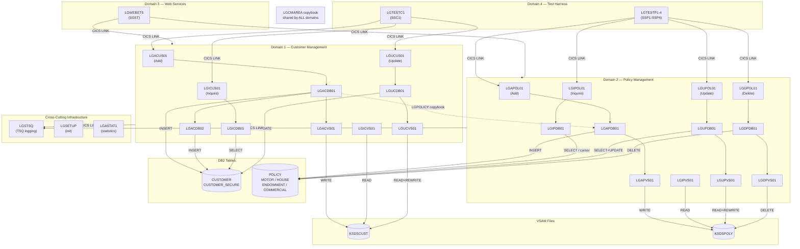

# GenApp — Functional Domains

Generated from local metadata database (local scan of `base/src`) and inventory in [`docs/01-inventory.md`](01-inventory.md).

---

## Summary

GenApp is structured around **four functional domains** and **two cross-cutting infrastructure components**:

| # | Domain | Business responsibility |
|---|---|---|
| 1 | **Customer** | Manage insurance customer records (add, inquire, update) |
| 2 | **Policy** | Manage insurance policy records (add, inquire, update, delete) across four product types |
| 3 | **Web Services** | Expose Customer and Policy operations as CICS web services to external consumers |
| 4 | **Test Harness** | Workload simulation and functional test drivers for Customer and Policy operations |
| — | **Infrastructure / Shared** | TSQ logging utility (`LGSTSQ`), setup utility (`LGSETUP`), statistics accumulator (`LGASTAT1`) |

---

## Domain 1 — Customer Management

### Business Responsibility
Create, retrieve, and update customer records. Customers are the master entities to which policies are attached. No delete operation exists for customers in this codebase.

### Programs

| Program | Layer | Role |
|---|---|---|
| [`LGACUS01`](../base/src/LGACUS01.cbl) | Presentation | Add Customer — COMMAREA handler, drives DB2 backend |
| [`LGACDB01`](../base/src/LGACDB01.cbl) | DB2 | Add Customer — writes to CUSTOMER and CUSTOMER_SECURE (via LGACDB02), writes to VSAM |
| [`LGACDB02`](../base/src/LGACDB02.cbl) | DB2 | Add Customer (secure path) — writes to CUSTOMER_SECURE |
| [`LGACVS01`](../base/src/LGACVS01.cbl) | VSAM | Add Customer — writes to KSDSCUST |
| [`LGICUS01`](../base/src/LGICUS01.cbl) | Presentation | Inquire Customer — COMMAREA handler, drives DB2 backend |
| [`LGICDB01`](../base/src/LGICDB01.cbl) | DB2 | Inquire Customer — reads CUSTOMER |
| [`LGICVS01`](../base/src/LGICVS01.cbl) | VSAM | Inquire Customer — reads KSDSCUST |
| [`LGUCUS01`](../base/src/LGUCUS01.cbl) | Presentation | Update Customer — COMMAREA handler, drives DB2 backend |
| [`LGUCDB01`](../base/src/LGUCDB01.cbl) | DB2 | Update Customer — updates CUSTOMER, reads/rewrites KSDSCUST |
| [`LGUCVS01`](../base/src/LGUCVS01.cbl) | VSAM | Update Customer — reads and rewrites KSDSCUST |

### Transactions
None owned directly — invoked via Test Harness transaction `SSC1` and Web Services transaction `SSST`.

### JCL
- [`wsaac01.jcl`](../base/cntl/wsaac01.jcl) — Web Service Assistant: Add Customer
- [`wsaic01.jcl`](../base/cntl/wsaic01.jcl) — Web Service Assistant: Inquire Customer
- [`wsauc01.jcl`](../base/cntl/wsauc01.jcl) — Web Service Assistant: Update Customer
- [`wsavc01.jcl`](../base/cntl/wsavc01.jcl) — Web Service Assistant: (Customer variant)

### Data Stores

| Store | Type | Access |
|---|---|---|
| `CUSTOMER` | DB2 table | INSERT (add), SELECT (inquire), UPDATE (update) |
| `CUSTOMER_SECURE` | DB2 table | INSERT only (add — secure path) |
| `KSDSCUST` | VSAM KSDS | WRITE (add), READ (inquire), READ+REWRITE (update) |

### Key Dependencies
- [`LGCMAREA`](../base/src/LGCMAREA.cpy) — COMMAREA copybook (shared with all domains)
- [`LGPOLICY`](../base/src/LGPOLICY.cpy) — Policy data structures (used in add/inquire paths)
- [`LGSTSQ`](../base/src/LGSTSQ.cbl) — TSQ logging (cross-cutting, called by every DB/VSAM program)

---

## Domain 2 — Policy Management

### Business Responsibility
Create, retrieve, update, and delete insurance policies. Supports four insurance product types: **Motor**, **House**, **Endowment**, and **Commercial**. Each policy is linked to a customer and has a product-specific detail record in a separate DB2 table.

### Programs

| Program | Layer | Role |
|---|---|---|
| [`LGAPOL01`](../base/src/LGAPOL01.cbl) | Orchestrator | Add Policy — routes to DB2 backend |
| [`LGAPDB01`](../base/src/LGAPDB01.cbl) | DB2 | Add Policy — inserts into POLICY + product sub-table, writes VSAM |
| [`LGAPVS01`](../base/src/LGAPVS01.cbl) | VSAM | Add Policy — writes to KSDSPOLY |
| [`LGIPOL01`](../base/src/LGIPOL01.cbl) | Orchestrator | Inquire Policy — routes to DB2 backend |
| [`LGIPDB01`](../base/src/LGIPDB01.cbl) | DB2 | Inquire Policy — reads POLICY and product sub-table (cursor-based) |
| [`LGIPVS01`](../base/src/LGIPVS01.cbl) | VSAM | Inquire Policy — reads KSDSPOLY |
| [`LGUPOL01`](../base/src/LGUPOL01.cbl) | Orchestrator | Update Policy — routes to DB2 backend |
| [`LGUPDB01`](../base/src/LGUPDB01.cbl) | DB2 | Update Policy — updates POLICY + product sub-tables (cursor-based) |
| [`LGUPVS01`](../base/src/LGUPVS01.cbl) | VSAM | Update Policy — reads and rewrites KSDSPOLY |
| [`LGDPOL01`](../base/src/LGDPOL01.cbl) | Orchestrator | Delete Policy — routes to DB2 backend |
| [`LGDPDB01`](../base/src/LGDPDB01.cbl) | DB2 | Delete Policy — deletes from POLICY |
| [`LGDPVS01`](../base/src/LGDPVS01.cbl) | VSAM | Delete Policy — deletes from KSDSPOLY |

### Transactions
None owned directly — invoked via Test Harness transactions `SSP1–SSP4` and Web Services `SSST`.

### JCL
- [`wsaap01.jcl`](../base/cntl/wsaap01.jcl) — Web Service Assistant: Add Policy
- [`wsaip01.jcl`](../base/cntl/wsaip01.jcl) — Web Service Assistant: Inquire Policy
- [`wsaup01.jcl`](../base/cntl/wsaup01.jcl) — Web Service Assistant: Update Policy
- [`wsavp01.jcl`](../base/cntl/wsavp01.jcl) — Web Service Assistant: (Policy variant)

### Data Stores

| Store | Type | Access |
|---|---|---|
| `POLICY` | DB2 table | INSERT+SELECT (add), SELECT+cursor (inquire), SELECT+UPDATE+cursor (update), DELETE (delete) |
| `MOTOR` | DB2 table | INSERT (add), SELECT (inquire), UPDATE (update) |
| `HOUSE` | DB2 table | INSERT (add), SELECT (inquire), UPDATE (update) |
| `ENDOWMENT` | DB2 table | INSERT (add), SELECT (inquire), UPDATE (update) |
| `COMMERCIAL` | DB2 table | INSERT (add), SELECT+cursor (inquire) |
| `KSDSPOLY` | VSAM KSDS | WRITE (add), READ (inquire), READ+REWRITE (update), DELETE (delete) |

### Key Dependencies
- [`LGCMAREA`](../base/src/LGCMAREA.cpy) — COMMAREA (shared)
- [`LGPOLICY`](../base/src/LGPOLICY.cpy) — Policy data structures (shared with Customer domain)
- [`LGSTSQ`](../base/src/LGSTSQ.cbl) — TSQ logging (cross-cutting)

---

## Domain 3 — Web Services Interface

### Business Responsibility
Expose Customer and Policy operations as CICS web services, enabling external (distributed) systems to invoke genapp operations over HTTP/SOAP without a 3270 terminal session.

### Programs

| Program | Layer | Role |
|---|---|---|
| [`LGWEBST5`](../base/src/LGWEBST5.cbl) | Entry-point | Web service handler — receives and dispatches CICS web service requests |

### Transactions

| Transaction | Program | Purpose |
|---|---|---|
| `SSST` | `LGWEBST5` | Entry transaction for all web service calls |

### JCL
- [`wsaac01.jcl`](../base/cntl/wsaac01.jcl) through [`wsavp01.jcl`](../base/cntl/wsavp01.jcl) — eight Web Service Assistant jobs that generate WSDL/binding artifacts for each operation (Add/Inquire/Update Customer and Add/Inquire/Update/Delete Policy)

### Data Stores
None directly — delegates to Customer and Policy domain programs via CICS LINK.

### External Interface
- **Protocol**: CICS Web Services (SOAP/HTTP)
- **Contract**: COMMAREA layout defined in [`LGCMAREA`](../base/src/LGCMAREA.cpy)
- **Direction**: Inbound (external consumer → mainframe)
- **Consumers**: Any HTTP/SOAP client using the generated WSDL

---

## Domain 4 — Test Harness

### Business Responsibility
Provide interactive BMS-screen-driven test drivers and workload simulation for Customer and Policy operations. Used for functional testing and performance workload generation.

### Programs

| Program | Transaction | Scope |
|---|---|---|
| [`LGTESTC1`](../base/src/LGTESTC1.cbl) | `SSC1` | Drives Customer Add, Inquire, Update |
| [`LGTESTP1`](../base/src/LGTESTP1.cbl) | `SSP1` | Drives Policy Add, Inquire, Update, Delete (variant 1) |
| [`LGTESTP2`](../base/src/LGTESTP2.cbl) | `SSP2` | Drives Policy Add, Inquire, Update, Delete (variant 2) |
| [`LGTESTP3`](../base/src/LGTESTP3.cbl) | `SSP3` | Drives Policy Add, Inquire, Update, Delete (variant 3) |
| [`LGTESTP4`](../base/src/LGTESTP4.cbl) | `SSP4` | Drives Policy Add, Inquire, Update, Delete (variant 4) |

### BMS Screen
- [`SSMAP`](../base/src/ssmap.bms) — single BMS map shared by all five test programs

### JCL
- [`sampcma.jcl`](../base/cntl/sampcma.jcl) — sample COMMAREA-based test execution
- [`sampncs.jcl`](../base/cntl/sampncs.jcl) — sample NCS test
- [`samptsq.jcl`](../base/cntl/samptsq.jcl) — sample TSQ test
- [`sampwui.jcl`](../base/cntl/sampwui.jcl) — sample Web UI test

### Data Stores
None directly — all data access is through Customer and Policy domain programs.

---

## Cross-Cutting Infrastructure

### LGSTSQ — TSQ Logging Utility

[`LGSTSQ`](../base/src/LGSTSQ.cbl) is **called by every DB and VSAM tier program** in Customer and Policy domains. It writes diagnostic/audit messages to a CICS Temporary Storage Queue. It has no domain affiliation — it is a shared infrastructure component.

### LGSETUP — Initialisation Utility

[`LGSETUP`](../base/src/LGSETUP.cbl) initialises VSAM files and DB2 tables for the application. It is a one-time/admin utility, not part of any operational domain.

### LGASTAT1 — Statistics Accumulator

[`LGASTAT1`](../base/src/LGASTAT1.cbl) accumulates statistical data using the COMMAREA structure. It uses the LGCMAREA copybook. Its exact invocation path is not visible in the call graph (not called by any scanned program) — it may be triggered by a separate transaction or event binding.

---

## Domain Map

---

## Domain Interaction Summary

| From | To | Mechanism | Data |
|---|---|---|---|
| Test Harness | Customer domain | CICS LINK | LGCMAREA COMMAREA |
| Test Harness | Policy domain | CICS LINK | LGCMAREA COMMAREA |
| Web Services | Customer domain | CICS LINK (via LGWEBST5) | LGCMAREA COMMAREA |
| Web Services | Policy domain | CICS LINK (via LGWEBST5) | LGCMAREA COMMAREA |
| Customer domain | Infrastructure (LGSTSQ) | CICS LINK | TSQ diagnostic messages |
| Policy domain | Infrastructure (LGSTSQ) | CICS LINK | TSQ diagnostic messages |
| Customer domain | DB2 | Embedded SQL | CUSTOMER, CUSTOMER_SECURE |
| Customer domain | VSAM | CICS File Control | KSDSCUST |
| Policy domain | DB2 | Embedded SQL | POLICY, MOTOR, HOUSE, ENDOWMENT, COMMERCIAL |
| Policy domain | VSAM | CICS File Control | KSDSPOLY |
| Customer & Policy | Shared copybooks | COPY | LGCMAREA (COMMAREA), LGPOLICY (policy structures), SQLCA |

---

## Batch Processing

**There is no standalone batch processing** in GenApp. All processing is online (CICS-driven). The JCL members in `base/cntl/` serve three purposes only:

1. **Build jobs** — compile COBOL, assemble BMS (`cobol.jcl`, `asmmap.jcl`)
2. **Environment setup** — create/drop DB2 tables, bind packages, define CICS/CICSPlex resources (`db2cre.jcl`, `db2del.jcl`, `db2bind.jcl`, `adef*.jcl`, `cdef*.jcl`)
3. **Web service generation** — CICS Web Service Assistant artifacts (`wsa*.jcl`)
4. **Sample/test scripts** — sample execution scripts (`samp*.jcl`)

None of these JCL members represent operational batch jobs that process insurance data.
