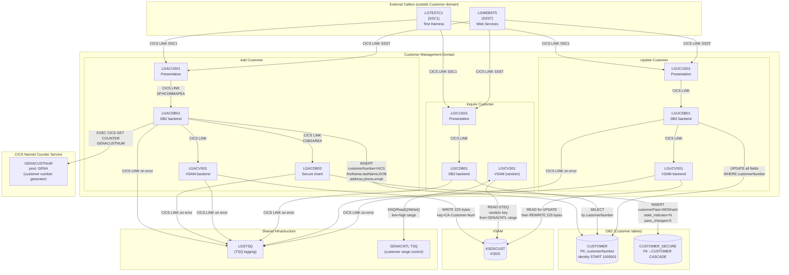

# Customer Management Domain — Boundary Analysis

Domain: **Customer Management**
Based on source code analysis of `base/src` and DDL in `base/cntl/db2cre.jcl`.

---

## 1. Components and Their Roles

### 1.1 CICS Programs

| Program | Layer | Owns/Shared | Role |
|---|---|---|---|
| [`LGACUS01`](../base/src/LGACUS01.cbl) | Presentation | **Customer only** | Add Customer — validates COMMAREA length, calls LGACDB01 |
| [`LGACDB01`](../base/src/LGACDB01.cbl) | DB2 | **Customer only** | Add Customer — obtains customer number from NCS, INSERTs into CUSTOMER, calls LGACVS01 and LGACDB02 |
| [`LGACDB02`](../base/src/LGACDB02.cbl) | DB2 (security) | **Customer only** | Add Customer (secure path) — INSERTs initial password record into CUSTOMER_SECURE |
| [`LGACVS01`](../base/src/LGACVS01.cbl) | VSAM | **Customer only** | Add Customer — WRITEs customer record to KSDSCUST |
| [`LGICUS01`](../base/src/LGICUS01.cbl) | Presentation | **Customer only** | Inquire Customer — validates COMMAREA length, calls LGICDB01 |
| [`LGICDB01`](../base/src/LGICDB01.cbl) | DB2 | **Customer only** | Inquire Customer — SELECTs from CUSTOMER by customer number |
| [`LGICVS01`](../base/src/LGICVS01.cbl) | VSAM | **Customer only** | Inquire Customer (random) — reads KSDSCUST using ENQ/TSQ-based range, returns a random existing customer number |
| [`LGUCUS01`](../base/src/LGUCUS01.cbl) | Presentation | **Customer only** | Update Customer — validates request ID `01UCUS`, calls LGUCDB01 |
| [`LGUCDB01`](../base/src/LGUCDB01.cbl) | DB2 | **Customer only** | Update Customer — UPDATEs all mutable fields in CUSTOMER, calls LGUCVS01 |
| [`LGUCVS01`](../base/src/LGUCVS01.cbl) | VSAM | **Customer only** | Update Customer — READs for update then REWRITEs KSDSCUST record |

### 1.2 DB2 Tables

| Table | Ownership | Used by |
|---|---|---|
| `CUSTOMER` | **Customer domain only** | LGACDB01 (INSERT), LGICDB01 (SELECT), LGUCDB01 (UPDATE) |
| `CUSTOMER_SECURE` | **Customer domain only** | LGACDB02 (INSERT only — never read by any program) |

> `CUSTOMER_SECURE` has a DB2 FK `ON DELETE CASCADE` from `CUSTOMER`. Deleting a customer would automatically delete its security record — but no delete operation exists in this codebase.

### 1.3 VSAM Files

| File | Logical Name | Ownership | Used by |
|---|---|---|---|
| `KSDSCUST` | `KSDSCUST` | **Customer domain only** | LGACVS01 (WRITE), LGICVS01 (READ GTEQ), LGUCVS01 (READ update + REWRITE) |

### 1.4 Copybooks

| Copybook | Ownership | Role |
|---|---|---|
| [`LGCMAREA`](../base/src/LGCMAREA.cpy) | **Shared — all domains** | COMMAREA layout — universal inter-program communication contract |
| [`LGPOLICY`](../base/src/LGPOLICY.cpy) | **Shared — Customer + Policy** | Policy data structures and field-length constants (Customer uses `WS-CUSTOMER-LEN`) |
| [`SQLCA`](../base/src/SQLCA.cpy) | **Shared — all DB2 programs** | SQL Communication Area |

### 1.5 CICS Infrastructure

| Resource | Type | Ownership | Role |
|---|---|---|---|
| `LGSTSQ` | Program | **Shared — all domains** | TSQ logging utility — called by every DB and VSAM program on error |
| `GENACNTL` | TSQ (Temporary Storage Queue) | **Customer domain only** | Control queue used by LGICVS01 to store low/high customer number range for random selection |
| `GENACUSTNUM` (counter name) | Named Counter Service (NCS) | **Customer domain only** | Provides monotonically increasing customer numbers via CICS GET COUNTER |
| `GENA` (NCS pool) | Named Counter Service pool | **Shared** | NCS pool also used by LGWEBST5 for statistics counters |

### 1.6 JCL (Web Service Assistant)

| JCL | Operation | Owned by |
|---|---|---|
| [`wsaac01.jcl`](../base/cntl/wsaac01.jcl) | Add Customer web service | Customer domain |
| [`wsaic01.jcl`](../base/cntl/wsaic01.jcl) | Inquire Customer web service | Customer domain |
| [`wsauc01.jcl`](../base/cntl/wsauc01.jcl) | Update Customer web service | Customer domain |
| [`wsavc01.jcl`](../base/cntl/wsavc01.jcl) | Customer variant web service | Customer domain |

### 1.7 BMS Screens
None — the Customer domain has no BMS screen of its own. The BMS screen `SSMAP` is owned by the Test Harness domain.

---

## 2. Domain Boundary Diagram

---

## 3. Batch Processing

**There is no batch processing in the Customer domain.** All customer operations are exclusively online CICS transactions. The JCL in `base/cntl/` related to Customer (`wsaac01.jcl`, `wsaic01.jcl`, `wsauc01.jcl`, `wsavc01.jcl`) are Web Service Assistant build jobs — they generate WSDL/binding artifacts and do not process customer data at runtime.

---

## 4. DB2 Usage — All Programs Accessing Customer Tables

| Program | Domain | Table | Access | Notes |
|---|---|---|---|---|
| `LGACDB01` | Customer | `CUSTOMER` | INSERT | Uses NCS counter if available; falls back to DB2 identity (`DEFAULT`) |
| `LGACDB02` | Customer | `CUSTOMER_SECURE` | INSERT | Hardcoded default password hash; state=`N`; pass_changes=0 |
| `LGICDB01` | Customer | `CUSTOMER` | SELECT | By `CUSTOMERNUMBER`; returns SQLCODE 100 as return code `01` |
| `LGUCDB01` | Customer | `CUSTOMER` | UPDATE | All nine mutable fields; SQLCODE 100 → RC `01` |
| _(no other program)_ | — | — | — | `CUSTOMER` and `CUSTOMER_SECURE` are touched exclusively by Customer domain programs |

---

## 5. Integration Points with Other Domains

These are the **seams to modify** when the Customer domain moves off the mainframe:

| Caller | Domain | Callee | Domain | Mechanism | Data passed | Migration note |
|---|---|---|---|---|---|---|
| `LGTESTC1` | Test Harness | `LGACUS01` | Customer | CICS LINK | `DFHCOMMAREA` (LGCMAREA layout, 32,500 bytes) | Test harness must call the new API endpoint instead of CICS LINK |
| `LGTESTC1` | Test Harness | `LGICUS01` | Customer | CICS LINK | `DFHCOMMAREA` | Same |
| `LGTESTC1` | Test Harness | `LGUCUS01` | Customer | CICS LINK | `DFHCOMMAREA` | Same |
| `LGWEBST5` | Web Services | Customer programs | Customer | CICS LINK | `DFHCOMMAREA` | LGWEBST5 is the existing HTTP bridge — it may be replaced or extended |
| `LGACDB01` | Customer | `LGSTSQ` | Infra | CICS LINK | Error message (date/time/program/SQLCODE) | LGSTSQ must remain on mainframe or be replaced with equivalent logging |
| All Customer DB/VSAM programs | Customer | `LGSTSQ` | Infra | CICS LINK | Diagnostic messages | Same |
| `LGUCDB01` (LGPOLICY copybook) | Customer | Policy domain (shared copybook) | Policy | COPY | `WS-CUSTOMER-LEN` length constant only | No runtime dependency — compile-time only; the length constant can be inlined in the migrated service |

> **Key finding**: The only runtime cross-domain dependency entering the Customer domain is `LGTESTC1` (Test Harness) and `LGWEBST5` (Web Services) calling the three Customer presentation programs via CICS LINK. Both use the `LGCMAREA` COMMAREA as the wire contract. These two call sites are the **sole integration points to cut** during migration.

---

## 6. External Interfaces

| Interface | Direction | Protocol | Entry program | Contract | Consumers |
|---|---|---|---|---|---|
| CICS Web Services — Add Customer | Inbound | SOAP/HTTP | `LGWEBST5` → `LGACUS01` | `LGCMAREA` COMMAREA (mapped to WSDL by `wsaac01.jcl`) | Any HTTP/SOAP client with generated WSDL |
| CICS Web Services — Inquire Customer | Inbound | SOAP/HTTP | `LGWEBST5` → `LGICUS01` | `LGCMAREA` COMMAREA (mapped to WSDL by `wsaic01.jcl`) | Any HTTP/SOAP client |
| CICS Web Services — Update Customer | Inbound | SOAP/HTTP | `LGWEBST5` → `LGUCUS01` | `LGCMAREA` COMMAREA (mapped to WSDL by `wsauc01.jcl`) | Any HTTP/SOAP client |

> No MQ queues, IMS interfaces, sockets, file transfers, CTG/EPI, or DPL interfaces exist for the Customer domain. The only external interface is CICS Web Services via `LGWEBST5`.

> The CICS Named Counter Service (`GENACUSTNUM`) is an internal CICS platform service — it is not an external interface, but it must be replaced in the target platform with an equivalent sequence generator.
