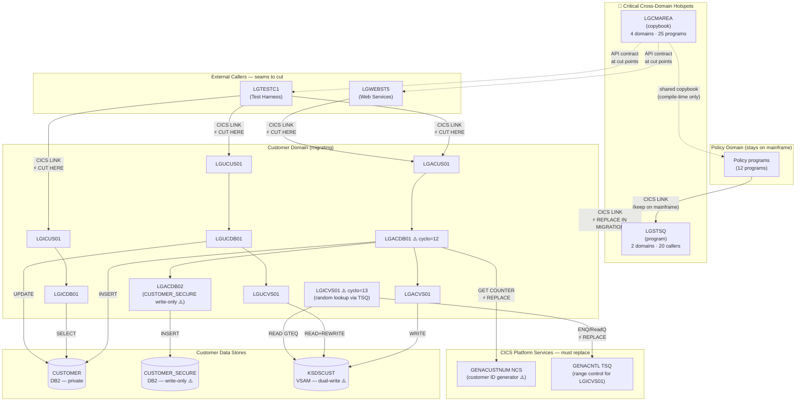

# Customer Management Domain — Migration Hotspots

Domain: **Customer Management**
Based on source code analysis, domain boundary analysis ([`04-domain-customer-boundary.md`](04-domain-customer-boundary.md)), and application-wide dependency metrics.

---

## Part 1 — Customer Domain Migration Hotspots (Step 8.1)

These are the specific components that require the most attention when migrating the Customer domain off the mainframe.

### 1.1 Hotspot Summary

| Rank | Hotspot | Type | Risk | Why it matters |
|---|---|---|---|---|
| 1 | `LGCMAREA` copybook | Shared API contract | 🔴 HIGH | Universal COMMAREA used by all 25 programs across all domains — is the wire contract between callers and Customer |
| 2 | `LGSTSQ` utility program | Shared infrastructure | 🔴 HIGH | Called by all 10 Customer DB/VSAM programs; removing CICS LINK to it requires replacing with equivalent logging |
| 3 | `LGACDB01` — NCS + dual-write logic | Internal program | 🟠 MEDIUM | Most complex Customer program (cyclomatic 12); owns customer number generation via NCS, DB2 insert, VSAM write, and security record creation in a single non-atomic sequence |
| 4 | CICS Named Counter Service `GENACUSTNUM` | CICS platform service | 🟠 MEDIUM | Generates customer numbers; not available outside CICS — must be replaced with a sequence generator in the target platform |
| 5 | `CUSTOMER_SECURE` table — write-only anomaly | DB2 table | 🟠 MEDIUM | Written by `LGACDB02` on every add; never read by any program — migration must decide whether to carry this table or treat it as dead data |
| 6 | DB2 ↔ VSAM dual-write (non-atomic) | Architectural pattern | 🟠 MEDIUM | Customer data exists in both DB2 (`CUSTOMER`) and VSAM (`KSDSCUST`); updates are not atomic — potential inconsistency on failure (BR-C-18) |
| 7 | `LGPOLICY` copybook (shared with Policy domain) | Shared copybook | 🟡 LOW | Customer programs use only `WS-CUSTOMER-LEN` constant from it; compile-time dependency only — no runtime coupling to Policy |
| 8 | `LGICVS01` — TSQ-based random customer selection | Internal program | 🟡 LOW | Most complex VSAM program (cyclomatic 13); uses `GENACNTL` TSQ range and CICS ENQ/DEQ for concurrency control; unusual semantics (returns a random number, not a specific lookup) |
| 9 | CICS abend codes `LGCA`, `LGV0`, `LGV1`, `LGV2` | Error handling | 🟡 LOW | Abend codes used in place of structured error returns for critical failures; target platform must handle these differently |

---

### 1.2 Hotspot Detail

#### H1 — `LGCMAREA` Copybook (🔴 HIGH)

**What it is**: The universal COMMAREA layout copied by 25 of 31 programs. It defines the 32,500-byte inter-program communication structure including `CA-REQUEST-ID`, `CA-RETURN-CODE`, `CA-CUSTOMER-NUM`, and all policy-specific overlays via REDEFINES.

**Why it is a hotspot**: Every caller of the Customer domain (Test Harness, Web Services) passes data using this layout. It is the **API contract**. When Customer moves off mainframe, this contract must be formally defined and versioned — whether as a REST/JSON schema, a Protobuf, or a WSDL.

**Migration action**: Map `LGCMAREA` fields to the target API model. Specifically for Customer: `CA-REQUEST-ID`, `CA-RETURN-CODE`, `CA-CUSTOMER-NUM`, and the `CA-CUSTOMER-REQUEST` REDEFINES group (fields: first name, last name, DOB, house name/number, postcode, mobile phone, home phone, email, num-policies).

**Callers to update**:
- [`LGTESTC1`](../base/src/LGTESTC1.cbl) — CICS LINK calls to LGACUS01, LGICUS01, LGUCUS01
- [`LGWEBST5`](../base/src/LGWEBST5.cbl) — CICS LINK to Customer presentation programs

---

#### H2 — `LGSTSQ` Shared Logging Utility (🔴 HIGH)

**What it is**: A CICS program called by every DB and VSAM program in the application via `EXEC CICS LINK PROGRAM('LGSTSQ')`. It writes diagnostic messages to a CICS Temporary Storage Queue.

**Why it is a hotspot**: All 10 Customer DB/VSAM programs have a hard-coded CICS LINK to `LGSTSQ`. It cannot be deployed with the migrated service — the CICS LINK will be invalid in a non-CICS runtime.

**Programs calling it from Customer domain**: LGACDB01, LGACDB02, LGACUS01, LGACVS01, LGICUS01, LGICDB01, LGUCDB01, LGUCUS01, LGUCVS01, and their shared error paths.

**Migration action**: Replace every `EXEC CICS LINK PROGRAM('LGSTSQ')` call in the 10 migrated programs with an equivalent logging call (e.g., write to a cloud logging service, stdout, or a message queue). `LGSTSQ` must remain on the mainframe for the remaining Policy domain programs.

---

#### H3 — `LGACDB01` Non-Atomic Multi-Step Add (🟠 MEDIUM)

**What it is**: The Add Customer DB2 backend is the most complex Customer program (cyclomatic complexity 12). It executes a 4-step sequence:
1. `EXEC CICS GET COUNTER` from NCS (`GENACUSTNUM`) — get next customer number
2. `EXEC SQL INSERT INTO CUSTOMER` — with NCS number (or DB2 identity fallback)
3. `EXEC CICS LINK LGACVS01` — write VSAM record
4. `EXEC CICS LINK LGACDB02` — write security record to `CUSTOMER_SECURE`

**Why it is a hotspot**: Steps 1–4 are **not wrapped in a single transaction**. If step 3 or 4 fails, the DB2 insert in step 2 is not rolled back. This is a deliberate pattern in the current CICS architecture (each LINK is a separate UoW boundary), but it is an **explicit inconsistency risk** that the target system must address — either by making the sequence atomic (e.g., a distributed transaction, saga, or compensating write) or by accepting eventual consistency.

**Migration action**: Decide transaction boundary strategy for Add Customer. Options: (a) wrap all steps in an atomic service transaction; (b) implement a compensating transaction to clean up partial failures; (c) accept the existing non-atomic pattern and document it.

---

#### H4 — CICS Named Counter Service `GENACUSTNUM` (🟠 MEDIUM)

**What it is**: LGACDB01 uses `EXEC CICS GET COUNTER(GENACUSTNUM) POOL(GENA)` to obtain a unique, monotonically increasing customer number before inserting into DB2. If the NCS call fails, the program falls back to `INSERT … DEFAULT` and retrieves the DB2 identity-assigned value.

**Why it is a hotspot**: NCS is a CICS-specific service — it has no equivalent outside CICS. The target platform needs a replacement sequence generator that guarantees uniqueness and monotonicity.

**Migration action**: Replace NCS with a target-platform sequence (e.g., DB2 SEQUENCE, PostgreSQL SEQUENCE, Redis INCR, or UUID). The fallback path (`INSERT DEFAULT`) already shows the DB2 identity can serve as the generator — this may be the simplest migration path if the number format (integers starting at 1,000,001) is preserved.

---

#### H5 — `CUSTOMER_SECURE` Write-Only Anomaly (🟠 MEDIUM)

**What it is**: `LGACDB02` inserts a row into `CUSTOMER_SECURE` for every new customer with a hardcoded default password hash (`5732fec825535eeafb8fac50fee3a8aa`). No program in the codebase ever reads, updates, or deletes from `CUSTOMER_SECURE`.

**Why it is a hotspot**: This is dead data from the application perspective — it is written but never consumed. The target system must decide: (a) carry the table and the write, preserving the schema; (b) drop the write and the table (simplifies migration but changes behaviour); or (c) treat it as a stub for a future authentication system.

**DB2 constraint**: `CUSTOMER_SECURE` has a FK `ON DELETE CASCADE` from `CUSTOMER`. If the Customer domain is migrated and `CUSTOMER_SECURE` remains on the mainframe, the CASCADE delete becomes unreachable — a data integrity concern.

---

#### H6 — DB2 ↔ VSAM Dual-Write Pattern (🟠 MEDIUM)

**What it is**: Every Customer write operation (Add, Update) writes to both DB2 (`CUSTOMER`) and VSAM (`KSDSCUST`). The two writes are not in the same unit of work — VSAM is written via CICS LINK, which is a separate transaction context.

**Why it is a hotspot**: In the migrated service, VSAM is not available. The target must decide which store is authoritative and remove the dual-write:
- **Option A**: DB2 is the system of record; KSDSCUST is retired.
- **Option B**: Both stores are migrated; VSAM is replaced with an equivalent file store.

The `LGICVS01` program (random customer lookup) reads only KSDSCUST — if the VSAM file is retired, this program's behaviour changes.

---

#### H7 — `LGPOLICY` Shared Copybook (🟡 LOW)

**What it is**: The Customer domain includes `LGPOLICY` in four programs (LGACDB01, LGACDB02, LGACUS01, LGICDB01) to use only the length constant `WS-CUSTOMER-LEN = 72`.

**Why it is low risk**: This is a compile-time dependency only. The migrated Customer service can inline the constant `72` or define it locally — no runtime coupling to the Policy domain exists via this copybook.

---

#### H8 — `LGICVS01` TSQ-Based Random Lookup (🟡 LOW)

**What it is**: The VSAM inquire path does not do a specific customer lookup. Instead it uses CICS ENQ/DEQ, reads a control TSQ (`GENACNTL`) to find the current low/high customer number range, generates a random key using `EIBTASKN` as a seed, and reads the nearest KSDSCUST record with `GTEQ`.

**Why it matters**: This program's behaviour is entirely CICS- and VSAM-specific (ENQ, TSQ, CICS file GTEQ read). It provides workload simulation functionality, not a business customer lookup. In migration, it is either re-implemented (random customer selection from a DB query) or retired.

---

## Part 2 — Application-Wide Hotspots (Step 8.2)

These are components used by the **largest number of domains** across the whole application, making them most critical to change regardless of which domain moves first.

### 2.1 Application-Wide Hotspot Ranking

| Rank | Component | Type | Domains depending on it | Used by Customer? | Risk |
|---|---|---|---|---|---|
| 1 | `LGCMAREA` copybook | Copybook | **All 4 domains** (Customer, Policy, Test Harness, Web Services) — 25 programs | ✅ Yes — all 6 Customer presentation/DB programs | 🔴 CRITICAL |
| 2 | `LGSTSQ` program | Shared program | **Customer + Policy** domains — 20 programs | ✅ Yes — 10 Customer programs | 🔴 CRITICAL |
| 3 | `LGPOLICY` copybook | Copybook | **Customer + Policy** — 10 programs | ✅ Yes — 4 Customer programs (length constant only) | 🟠 HIGH |
| 4 | `POLICY` DB2 table | DB2 table | **Policy domain only** — 4 programs | ❌ No | 🟠 HIGH (for Policy migration) |
| 5 | `SQLCA` copybook | Copybook | **Customer + Policy** — 8 programs | ✅ Yes — 4 Customer DB programs | 🟡 MEDIUM |
| 6 | `KSDSPOLY` VSAM file | VSAM | **Policy domain only** — 4 programs | ❌ No | 🟡 MEDIUM (for Policy migration) |
| 7 | `KSDSCUST` VSAM file | VSAM | **Customer domain only** — 3 programs | ✅ Yes — all 3 Customer VSAM programs | 🟡 MEDIUM |
| 8 | `CUSTOMER` DB2 table | DB2 table | **Customer domain only** — 3 programs | ✅ Yes | 🟡 MEDIUM |
| 9 | `SSMAP` BMS map | BMS screen | **Test Harness only** — 5 programs | ❌ No | 🟢 LOW |

### 2.2 Application-Wide Hotspot Detail

#### AW-1 — `LGCMAREA` — The Universal API Contract (🔴 CRITICAL)

- **25 programs** (all domains) copy it
- It is the **only communication contract** between every caller and every service — there is no other interface definition
- Any schema change to `LGCMAREA` cascades to all 25 programs simultaneously
- **For Customer migration**: This is the API to expose as the external contract (REST/SOAP/gRPC schema). It must be versioned and agreed before any code changes begin.
- If `LGCMAREA` is changed to accommodate a migrated Customer service, all Policy, Test Harness, and Web Services programs must also be updated.

```
Domain dependencies on LGCMAREA:
  Customer       : 6 programs  (LGACUS01, LGACDB01, LGACVS01, LGICUS01, LGUCUS01, LGUCVS01)
  Policy         : 12 programs (all orchestrators + DB + VSAM programs)
  Test Harness   : 5 programs  (LGTESTC1, LGTESTP1-4)
  Web Services   : 1 program   (via LGWEBST5 linkage section)
  Infrastructure : 1 program   (LGASTAT1)
```

#### AW-2 — `LGSTSQ` — Universal Logging Dependency (🔴 CRITICAL)

- **20 programs** across Customer and Policy domains call it
- It cannot be deployed off-mainframe — it uses CICS Temporary Storage Queue writes
- **For Customer migration**: All 10 Customer programs must have their `EXEC CICS LINK PROGRAM('LGSTSQ')` calls replaced. `LGSTSQ` must remain on mainframe for Policy domain programs.
- A stub `LGSTSQ` on the mainframe that re-routes logging to a cloud endpoint would allow a phased migration without touching Policy programs.

```
Callers of LGSTSQ:
  Customer domain  : 10 programs (all DB + VSAM programs)
  Policy domain    : 10 programs (all orchestrators + DB + VSAM programs)
```

#### AW-3 — `LGPOLICY` — Cross-Domain Data Structure Copybook (🟠 HIGH)

- **10 programs** across Customer and Policy copy it
- Contains DB2 host variable structures for all entity types (CUSTOMER, POLICY, MOTOR, HOUSE, ENDOWMENT, COMMERCIAL, CLAIM) plus field-length constants
- Customer programs use only `WS-CUSTOMER-LEN` (compile-time constant = 72)
- Policy programs use the full structure including `DB2-POLICY`, `DB2-MOTOR`, etc.
- **For Customer migration**: Customer programs can replace `COPY LGPOLICY` with an inline constant — no schema change needed in `LGPOLICY` itself.

---

## Part 3 — Boundary Diagram with Hotspots Annotated



---

## Part 4 — Ranked Migration Risk Summary

| Rank | Item | Risk | Action required |
|---|---|---|---|
| 1 | **`LGCMAREA`** — API contract for all domains | 🔴 CRITICAL | Define formal API schema from `CA-CUSTOMER-REQUEST` fields before any code changes |
| 2 | **`LGSTSQ`** — called by all DB/VSAM programs | 🔴 CRITICAL | Replace all 10 Customer CICS LINKs with target-platform logging; keep LGSTSQ on mainframe for Policy |
| 3 | **`LGACDB01` non-atomic sequence** | 🟠 MEDIUM-HIGH | Define transaction boundary strategy (saga / atomic / compensating) for the 4-step Add Customer |
| 4 | **CICS NCS `GENACUSTNUM`** | 🟠 MEDIUM | Replace with DB2 identity column (already a fallback in the code) or target-platform sequence |
| 5 | **`CUSTOMER_SECURE` write-only** | 🟠 MEDIUM | Decide: carry the write (keeps security stub for future use) or retire it; handle FK cascade |
| 6 | **DB2 ↔ VSAM dual-write** | 🟠 MEDIUM | Retire KSDSCUST in target; migrate `LGICVS01` random-lookup to a DB query |
| 7 | **CICS abend codes `LGCA`, `LGV0-2`** | 🟡 LOW | Replace with structured error responses in target platform |
| 8 | **`LGPOLICY` compile-time constant** | 🟡 LOW | Inline `WS-CUSTOMER-LEN = 72` in migrated code; no runtime change |
| 9 | **`LGICVS01` TSQ + ENQ concurrency** | 🟡 LOW | Re-implement as random DB query with equivalent concurrency control |
