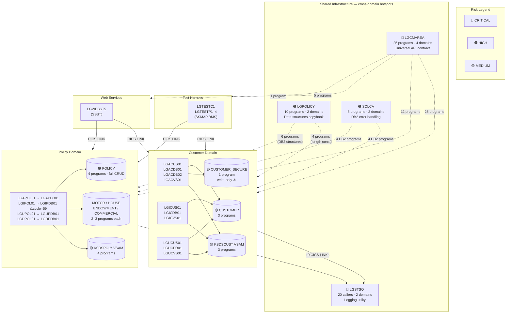

# GenApp — Application-Wide Hotspots

Generated from local metadata database (local scan of `base/src`).
Cross-references: [`docs/01-inventory.md`](01-inventory.md), [`docs/02-db2-crud-matrix.md`](02-db2-crud-matrix.md), [`docs/03-functional-domains.md`](03-functional-domains.md).

> **Purpose**: Identify the modules, copybooks, DB2 tables, VSAM files, and shared utilities that are used or called by the largest number of programs or domains across the whole application. These are the components most critical to any change — they have the widest blast radius.

---

## 1. Ranked Hotspot Overview

| Rank | Component | Type | Programs depending | Domains | Risk |
|---|---|---|---|---|---|
| 1 | `LGCMAREA` | Copybook | **25 / 31** (81%) | **All 4** | 🔴 CRITICAL |
| 2 | `LGSTSQ` | Shared program | **20 / 31** (65%) | Customer + Policy | 🔴 CRITICAL |
| 3 | `LGPOLICY` | Copybook | **10 / 31** (32%) | Customer + Policy | 🟠 HIGH |
| 4 | `SQLCA` | Copybook | **8 / 31** (26%) | Customer + Policy (DB2 programs) | 🟠 HIGH |
| 5 | `POLICY` | DB2 table | **4 programs** | Policy | 🟠 HIGH |
| 6 | `KSDSPOLY` | VSAM file | **4 programs** | Policy | 🟡 MEDIUM |
| 7 | `LGIPDB01` | Program | 1 caller, cyclomatic **59** | Policy | 🟡 MEDIUM |
| 8 | `CUSTOMER` | DB2 table | **3 programs** | Customer | 🟡 MEDIUM |
| 9 | `KSDSCUST` | VSAM file | **3 programs** | Customer | 🟡 MEDIUM |
| 10 | `CUSTOMER_SECURE` | DB2 table | **1 program** (write-only) | Customer | 🟡 MEDIUM (anomaly) |

---

## 2. Hotspot Detail

### 🔴 HS-1 — `LGCMAREA` Copybook

**Type**: COBOL copybook (API contract)
**Programs using it**: 25 of 31 (81%)
**Domains**: All 4 — Customer, Policy, Test Harness, Web Services
**Also used by**: `LGASTAT1` (infrastructure)

`LGCMAREA` is the **universal inter-program communication contract** for the entire application. It defines the 32,500-byte COMMAREA structure passed on every `EXEC CICS LINK` call between all programs. It contains `CA-REQUEST-ID` (operation routing), `CA-RETURN-CODE` (result), `CA-CUSTOMER-NUM`, and all policy-type-specific overlays via REDEFINES (`CA-CUSTOMER-REQUEST`, `CA-POLICY-REQUEST`, `CA-ENDOWMENT`, `CA-HOUSE`, `CA-MOTOR`, `CA-COMMERCIAL`, `CA-CLAIM`).

**Why it is critical**: Any change to a field layout, size, or the REDEFINES structure cascades to all 25 programs simultaneously. Adding a new field, changing a field length, or reorganising the REDEFINES requires recompiling and retesting all 25 programs.

**Anomaly**: `CA-CLAIM` is defined as a REDEFINES variant but no program ever populates or reads it — the Claim domain was never implemented (see claim investigation findings).

**Domains breakdown**:
```
Customer    :  6 programs  (LGACUS01, LGACDB01, LGACVS01, LGICUS01, LGUCUS01, LGUCVS01)
Policy      : 12 programs  (all orchestrators, DB2 backends, VSAM backends)
Test Harness:  5 programs  (LGTESTC1, LGTESTP1–4)
Web Services:  1 program   (LGWEBST5 — linkage section)
Infrastructure: 1 program  (LGASTAT1)
```

---

### 🔴 HS-2 — `LGSTSQ` Shared Logging Utility

**Type**: CICS program (shared infrastructure)
**Inbound callers**: 20 of 31 programs (65%)
**Domains**: Customer (10 callers) + Policy (10 callers)
**Outbound callees**: 0 (leaf node)
**Cyclomatic complexity**: 5

`LGSTSQ` is called by **every DB2 backend and VSAM backend program** in both Customer and Policy domains via `EXEC CICS LINK PROGRAM('LGSTSQ')`. It writes diagnostic/error messages to a CICS Temporary Storage Queue (TSQ). It is never called by test harness or web services programs directly.

**Why it is critical**: It is the single shared utility that creates a hard CICS runtime dependency in 20 programs. Any migration of a domain off the mainframe must resolve this dependency — the CICS LINK will be invalid in a non-CICS runtime. `LGSTSQ` itself cannot be migrated since it uses CICS TSQ writes. It must either remain on the mainframe (for Policy programs) while being replaced in migrated Customer programs, or be fronted by an interface that can route to cloud logging.

**Callers**:
```
Customer domain : LGACDB01, LGACDB02, LGACUS01, LGACVS01,
                  LGICUS01, LGICDB01, LGUCUS01, LGUCDB01, LGUCVS01
                  (+ LGIPVS01 path via error handling)
Policy domain   : LGAPOL01, LGAPDB01, LGAPVS01, LGIPOL01, LGIPDB01,
                  LGUPOL01, LGUPDB01, LGUPVS01, LGDPOL01, LGDPDB01, LGDPVS01
```

---

### 🟠 HS-3 — `LGPOLICY` Copybook

**Type**: COBOL copybook (data structures)
**Programs using it**: 10 of 31 (32%)
**Domains**: Customer (4 programs) + Policy (6 programs)

`LGPOLICY` defines DB2 host variable structures for all entity types: `DB2-CUSTOMER`, `DB2-POLICY`, `DB2-ENDOWMENT`, `DB2-HOUSE`, `DB2-MOTOR`, `DB2-COMMERCIAL`, `DB2-CLAIM`, plus the field-length constants `WS-CUSTOMER-LEN`, `WS-POLICY-LEN`, etc.

**Why it is critical**: It is the shared data contract between the Customer and Policy domains. Any DB2 schema change (adding a column, changing a field type) requires updating this copybook and recompiling all 10 dependent programs. The `DB2-CLAIM` structure is present but no associated SQL exists.

**Customer dependency**: Customer programs use only the `WS-CUSTOMER-LEN` (=72) length constant — a compile-time-only dependency. Policy programs use the full DB2 host variable structures at runtime.

---

### 🟠 HS-4 — `SQLCA` Copybook

**Type**: COBOL copybook (SQL error handling)
**Programs using it**: 8 of 31 (26%)
**Domains**: Customer DB2 programs + Policy DB2 programs

`SQLCA` is the IBM-supplied SQL Communication Area included in all programs that issue embedded SQL. It provides `SQLCODE`, `SQLERRM`, `SQLERRD`, and other error fields.

**Why it is critical**: All DB2-accessing programs depend on it. It is not application-owned — it is supplied by the DB2 precompiler. However, any change to the DB2 runtime (version upgrade, precompiler change) affects all 8 programs. In a migration context, programs moved off mainframe that continue to use Db2 still need `SQLCA` in their COBOL compile environment.

---

### 🟠 HS-5 — `POLICY` DB2 Table

**Type**: DB2 table
**Programs accessing**: 4 (LGAPDB01, LGIPDB01, LGUPDB01, LGDPDB01) — full CRUD
**Domains**: Policy only
**Operations**: INSERT, SELECT (direct + cursor), UPDATE, DELETE

`POLICY` is the **hub table of the Policy domain** — every policy operation touches it. It has a FK from CUSTOMER (`customerNumber`) and outbound FKs from all four sub-type tables (MOTOR, HOUSE, ENDOWMENT, COMMERCIAL) plus CLAIM. The `POLICY` table is never accessed by Customer domain programs directly.

**Why it is critical**: Any schema change (adding a column, changing `policyType` enumeration, altering the FK) cascades to all 4 Policy programs. `LGIPDB01` accesses it via cursor in 5 separate SELECT statements — the most complex SQL in the application.

**Anomaly**: `CLAIM` table has an `ON DELETE CASCADE` FK from `POLICY`. Deleting a policy automatically deletes all claims — but since no claims are ever inserted, this constraint is currently inert.

---

### 🟡 HS-6 — `KSDSPOLY` VSAM File

**Type**: VSAM KSDS file
**Programs accessing**: 4 (LGAPVS01, LGIPVS01, LGUPVS01, LGDPVS01)
**Domains**: Policy only
**Operations**: WRITE (add), READ (inquire), READ+REWRITE (update), DELETE (delete)

`KSDSPOLY` is the VSAM mirror of the DB2 policy data. Every policy write operation (add, update, delete) writes to both DB2 and KSDSPOLY in non-atomic sequence — same dual-write pattern as the Customer domain.

**Why it is critical**: It is the secondary policy store. In migration, a decision is required on whether to retire it or replace it. `LGIPVS01` provides random policy number lookup (same pattern as `LGICVS01` for customers).

---

### 🟡 HS-7 — `LGIPDB01` — Most Complex Program

**Type**: CICS COBOL program (Policy Inquire DB2 backend)
**Cyclomatic complexity**: **59** (highest in the application)
**Inbound callers**: 1 (LGIPOL01)
**Outbound callees**: 1 (LGSTSQ)
**Domains**: Policy

`LGIPDB01` implements the Inquire Policy operation for all four product types. It contains 13 paragraphs and issues SQL against 5 tables (POLICY, MOTOR, HOUSE, ENDOWMENT, COMMERCIAL) using both direct SELECT and cursor-based reads. Its cyclomatic complexity of **59** is nearly 3× the next most complex program (`LGUPDB01` at 29) and makes it the **highest-risk program to modify or migrate** in the entire application.

**Why it is critical**: High cyclomatic complexity means high branch count — more test cases required, higher probability of regression on change. It also uses SQL cursors with OPEN/FETCH/CLOSE loops for both POLICY and COMMERCIAL, which require careful handling in any target platform.

**Anomaly**: `DB2-CLAIMNUM-INT` host variable is declared in this program but never used in any SQL statement — a leftover from the incomplete Claim domain.

---

### 🟡 HS-8 — `CUSTOMER` DB2 Table

**Type**: DB2 table
**Programs accessing**: 3 (LGACDB01, LGICDB01, LGUCDB01)
**Domains**: Customer only
**Operations**: INSERT, SELECT, UPDATE (no DELETE)

`CUSTOMER` is the master entity table. The `POLICY` table holds a FK to it, meaning a customer cannot be deleted without first deleting all associated policies. No delete operation exists in the codebase.

**Note**: `CUSTOMER_SECURE` has an `ON DELETE CASCADE` FK from `CUSTOMER` — deleting a customer would cascade-delete its security record automatically. Since no customer delete exists, this constraint never fires.

---

### 🟡 HS-9 — `KSDSCUST` VSAM File

**Type**: VSAM KSDS file
**Programs accessing**: 3 (LGACVS01, LGICVS01, LGUCVS01)
**Domains**: Customer only
**Operations**: WRITE (add), READ GTEQ (random lookup), READ+REWRITE (update)

`KSDSCUST` is the VSAM mirror of DB2 `CUSTOMER`. `LGICVS01` uses it for random customer number selection via a TSQ-based range — this is workload simulation functionality, not a business lookup.

---

### 🟡 HS-10 — `CUSTOMER_SECURE` DB2 Table (Anomaly)

**Type**: DB2 table
**Programs accessing**: 1 (LGACDB02 — INSERT only)
**Domains**: Customer only
**Operations**: INSERT only — **never read, updated, or queried by any program**

`CUSTOMER_SECURE` stores a default password hash and state indicator for each new customer. It is populated on every Add Customer but never retrieved. It represents a security stub that was set up but never completed. It has a FK `ON DELETE CASCADE` from `CUSTOMER`.

**Why it is flagged**: Write-only tables indicate incomplete features or data that accumulates without being consumed. In migration planning, it must be explicitly classified: carry forward, retire, or defer.

---

## 3. Application-Wide Hotspot Map



---

## 4. Complexity Hotspots — Programs by Cyclomatic Score

Programs with high cyclomatic complexity are hardest to test, modify, and migrate.

| Program | Domain | Cyclomatic | Inbound callers | Key complexity driver |
|---|---|---|---|---|
| [`LGIPDB01`](../base/src/LGIPDB01.cbl) | Policy | **59** | 1 | Multi-type policy inquiry with 5 tables, 2 cursors, 13 paragraphs |
| [`LGUPDB01`](../base/src/LGUPDB01.cbl) | Policy | **29** | 1 | Multi-type policy update with cursor-based POLICY + 3 sub-type UPDATEs |
| [`LGAPDB01`](../base/src/LGAPDB01.cbl) | Policy | **22** | 1 | Multi-type policy add with branching on 4 product types |
| [`LGTESTP4`](../base/src/LGTESTP4.cbl) | Test Harness | **16** | 0 | Workload simulation loop |
| [`LGTESTC1`](../base/src/LGTESTC1.cbl) | Test Harness | **13** | 0 | Customer test driver with BMS screen handling |
| [`LGICVS01`](../base/src/LGICVS01.cbl) | Customer | **13** | 0 | TSQ-based random customer selection with ENQ/DEQ |
| [`LGTESTP1`](../base/src/LGTESTP1.cbl) | Test Harness | **12** | 0 | Policy test driver |
| [`LGTESTP2`](../base/src/LGTESTP2.cbl) | Test Harness | **12** | 0 | Policy test driver |
| [`LGTESTP3`](../base/src/LGTESTP3.cbl) | Test Harness | **12** | 0 | Policy test driver |
| [`LGACDB01`](../base/src/LGACDB01.cbl) | Customer | **12** | 1 | NCS counter + dual INSERT paths + VSAM + security sub-call |
| [`LGUPOL01`](../base/src/LGUPOL01.cbl) | Policy | **11** | 3 | Policy update orchestrator |

> **`LGIPDB01` (cyclomatic=59) is the highest-risk program in the application**. It would require the most test cases to validate after any change and is the most complex program to re-implement in a migration.

---

## 5. Summary Table — Impact Blast Radius

| Component | Breadth (programs) | Depth (domains) | Change risk | Migration risk |
|---|---|---|---|---|
| `LGCMAREA` | 25 (81%) | 4/4 | 🔴 Any field change recompiles 25 programs | 🔴 Must be versioned as formal API before migration |
| `LGSTSQ` | 20 (65%) | 2/4 | 🔴 Any change affects 20 callers | 🔴 Cannot run outside CICS — must be replaced in any migrated domain |
| `LGPOLICY` | 10 (32%) | 2/4 | 🟠 Schema changes cascade to 10 programs | 🟠 Customer can inline length constant; Policy needs runtime structure |
| `SQLCA` | 8 (26%) | 2/4 | 🟠 DB2 version changes affect all 8 | 🟠 Stays with any DB2-connected program |
| `POLICY` table | 4 (13%) | 1/4 | 🟠 Schema change affects 4 Policy programs | 🟠 Full CRUD from 4 programs — hub of Policy domain |
| `KSDSPOLY` | 4 (13%) | 1/4 | 🟡 VSAM schema change affects 4 programs | 🟡 Retire or replace in Policy migration |
| `LGIPDB01` | 1 caller | 1/4 | 🟡 High internal complexity (cyclo=59) | 🟡 Hardest single program to re-implement |
| `CUSTOMER` table | 3 (10%) | 1/4 | 🟡 Schema change affects 3 programs | 🟡 Private to Customer domain — clean migration boundary |
| `KSDSCUST` | 3 (10%) | 1/4 | 🟡 VSAM schema affects 3 programs | 🟡 Retire in Customer migration |
| `CUSTOMER_SECURE` | 1 (3%) | 1/4 | 🟡 Write-only anomaly | 🟡 Classify: carry forward or retire |
