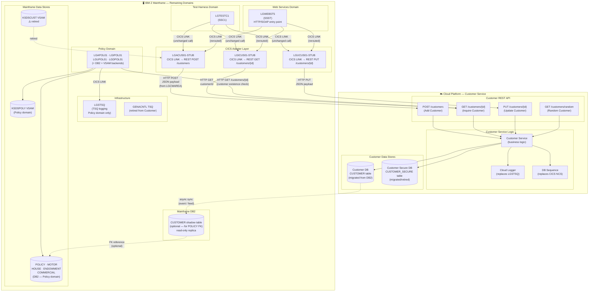
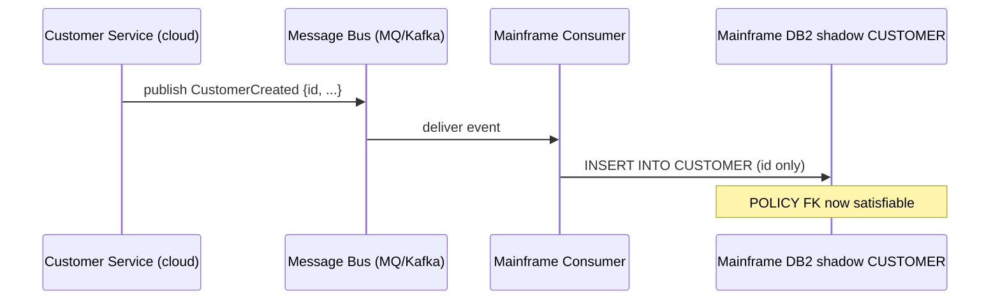
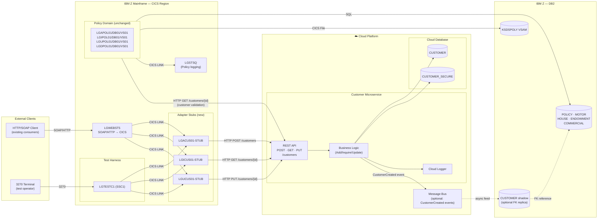

# To-Be Architecture — Customer Domain Migrated to Cloud

Domain: **Customer Management** (migrated)
Remaining on mainframe: **Policy**, **Web Services (LGWEBST5)**, **Test Harness**, **Infrastructure**

Based on boundary analysis ([`04`](04-domain-customer-boundary.md)), migration plan ([`08`](08-domain-customer-migration-plan.md)).

---

## 1. Architecture Overview

In the to-be state, the Customer Management domain runs as a **cloud-hosted microservice** exposing a REST API. The mainframe retains the Policy domain, Test Harness, Web Services entry point, and shared infrastructure (`LGSTSQ`). The two systems are integrated via a **CICS adapter layer** on the mainframe that bridges CICS LINK calls to HTTP REST calls against the Customer service.



---

## 2. Component Inventory — To-Be State

### 2.1 New components (cloud)

| Component | Type | Description |
|---|---|---|
| **Customer REST API** | Cloud microservice | Exposes Add, Inquire, Update Customer as REST endpoints; replaces LGACUS01, LGICUS01, LGUCUS01 and their backends |
| **Customer DB** | Cloud relational DB | Holds `CUSTOMER` and `CUSTOMER_SECURE` tables; migrated from mainframe DB2 |
| **DB Sequence / Identity** | Cloud DB feature | Replaces CICS Named Counter Service (`GENACUSTNUM`); generates customer numbers |
| **Cloud Logger** | Cloud logging service | Replaces `LGSTSQ` calls in Customer programs |

### 2.2 New components (mainframe adapter layer)

| Component | Type | Description |
|---|---|---|
| **LGACUS01-STUB** | CICS COBOL stub | Replaces `LGACUS01` on mainframe; receives CICS LINK with `LGCMAREA` COMMAREA, marshals to JSON, calls `POST /customers`, unmarshals response back to COMMAREA |
| **LGICUS01-STUB** | CICS COBOL stub | Replaces `LGICUS01`; calls `GET /customers/{id}`, maps response to COMMAREA |
| **LGUCUS01-STUB** | CICS COBOL stub | Replaces `LGUCUS01`; calls `PUT /customers/{id}`, maps response to COMMAREA |

> The stubs preserve the exact CICS LINK interface (`DFHCOMMAREA` with `LGCMAREA` layout and `LENGTH(32500)`). Callers (`LGTESTC1`, `LGWEBST5`) require **no code changes** — they still issue the same CICS LINK calls against the same program names.

### 2.3 Components retired

| Component | Reason |
|---|---|
| `LGACDB01`, `LGACDB02`, `LGACVS01` | Replaced by Customer REST API Add endpoint |
| `LGICDB01`, `LGICVS01` | Replaced by Customer REST API Inquire endpoint |
| `LGUCDB01`, `LGUCVS01` | Replaced by Customer REST API Update endpoint |
| `KSDSCUST` VSAM file | Retired — DB is the single store; random lookup via DB query |
| CICS NCS `GENACUSTNUM` | Retired — replaced by DB sequence |
| `GENACNTL` TSQ | Retired — random customer lookup via DB query |

### 2.4 Components unchanged on mainframe

| Component | Status |
|---|---|
| `LGTESTC1` | Unchanged — still issues CICS LINK to stub programs |
| `LGTESTP1–4` | Unchanged — Policy domain; unaffected |
| `LGWEBST5` | Unchanged if stubs match program names; or rerouted to call Customer API directly |
| All Policy programs | Unchanged — Policy domain stays on mainframe |
| `LGSTSQ` | Unchanged — used only by Policy domain after Customer migration |
| `LGCMAREA` copybook | Unchanged — remains the COMMAREA contract between stubs and callers |
| `POLICY`, `MOTOR`, `HOUSE`, `ENDOWMENT`, `COMMERCIAL` DB2 tables | Unchanged |
| `KSDSPOLY` VSAM | Unchanged |

---

## 3. Integration Patterns

### 3.1 CICS Adapter Stub Pattern

The adapter stubs are the key integration mechanism. Each stub:

1. Receives `EXEC CICS LINK` from an existing caller with a standard `LGCMAREA` COMMAREA
2. Extracts the relevant fields from the COMMAREA
3. Marshals them to a JSON request body
4. Calls the Customer REST API using `EXEC CICS WEB SEND` or CICS Web Services outbound call
5. Receives the JSON response
6. Unmarshals the response fields back into the COMMAREA
7. Returns to the caller via `EXEC CICS RETURN`

```
LGTESTC1                LGACUS01-STUB (mainframe)           Customer API (cloud)
    │                           │                                    │
    │  EXEC CICS LINK            │                                    │
    │  PROGRAM('LGACUS01')       │                                    │
    │  COMMAREA(LGCMAREA)  ────► │                                    │
    │                            │  marshal LGCMAREA to JSON          │
    │                            │  EXEC CICS WEB SEND ─────────────► │
    │                            │                          POST /customers
    │                            │                          { firstName, lastName, ... }
    │                            │ ◄───────────────────────────────── │
    │                            │  { customerId: 1000042, rc: "00" } │
    │                            │  unmarshal → LGCMAREA              │
    │ ◄────────────────────────  │                                    │
    │  CA-RETURN-CODE='00'        │                                    │
    │  CA-CUSTOMER-NUM=1000042    │                                    │
```

### 3.2 COMMAREA → REST Mapping

| Operation | COMMAREA fields (in) | REST call | COMMAREA fields (out) |
|---|---|---|---|
| Add Customer | `CA-FIRST-NAME`, `CA-LAST-NAME`, `CA-DOB`, `CA-HOUSE-NAME`, `CA-HOUSE-NUM`, `CA-POSTCODE`, `CA-PHONE-MOBILE`, `CA-PHONE-HOME`, `CA-EMAIL-ADDRESS` | `POST /customers` | `CA-CUSTOMER-NUM` (assigned), `CA-RETURN-CODE` |
| Inquire Customer | `CA-CUSTOMER-NUM` | `GET /customers/{id}` | All 9 customer fields, `CA-RETURN-CODE` |
| Update Customer | `CA-CUSTOMER-NUM` + all 9 fields | `PUT /customers/{id}` | `CA-RETURN-CODE` |

### 3.3 Policy FK Management

After migration, the mainframe DB2 `POLICY` table's FK `REFERENCES customer(customerNumber)` points to a table that no longer exists in mainframe DB2. Two options:

**Option A (recommended for demo)** — Application-level enforcement:

```
LGAPOL01 (Policy Orchestrator)
    │
    ├── Call Customer API: GET /customers/{CA-CUSTOMER-NUM}
    │   ├── RC=00 (found) → proceed with policy insert
    │   └── RC=01 (not found) → return error to caller
    │
    └── EXEC CICS LINK LGAPDB01 (Policy DB2 insert)
```

**Option B (production)** — Shadow CUSTOMER table:
- Customer API publishes `CustomerCreated` / `CustomerUpdated` events to a message bus (e.g., IBM MQ, Kafka)
- A mainframe consumer writes to a read-only shadow `CUSTOMER` table in DB2
- `POLICY` FK constraint references the shadow table — RI preserved without application changes



---

## 4. To-Be Architecture — Layered View



---

## 5. Key Architecture Decisions

| Decision | Choice | Rationale |
|---|---|---|
| Integration pattern | **CICS adapter stubs on mainframe** | Callers (`LGTESTC1`, `LGWEBST5`) need zero code changes; stub preserves the existing CICS LINK contract |
| API protocol | **REST / JSON over HTTP** | Industry standard; CICS supports outbound HTTP via `EXEC CICS WEB SEND`; simple to expose from cloud |
| Customer number generation | **DB sequence (identity column)** | Already a fallback in `LGACDB01`; no schema change needed |
| VSAM retirement | **Retire KSDSCUST** | DB is the authoritative store; VSAM was a mirror only |
| POLICY FK management | **Application-level enforcement (demo)** or **shadow table (production)** | Demo: simpler, no schema change; Production: preserves DB RI |
| Security record (`CUSTOMER_SECURE`) | **Carry forward** | Minimal effort; preserves intent of future auth flow |
| Logging | **Cloud-native logging replaces LGSTSQ** | LGSTSQ stays on mainframe for Policy domain; Customer service uses cloud observability |
| Policy customer validation | **HTTP GET /customers/{id} before policy insert** | Replaces DB2 FK constraint; ensures cross-platform referential integrity |
