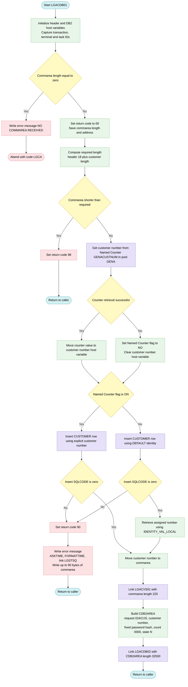
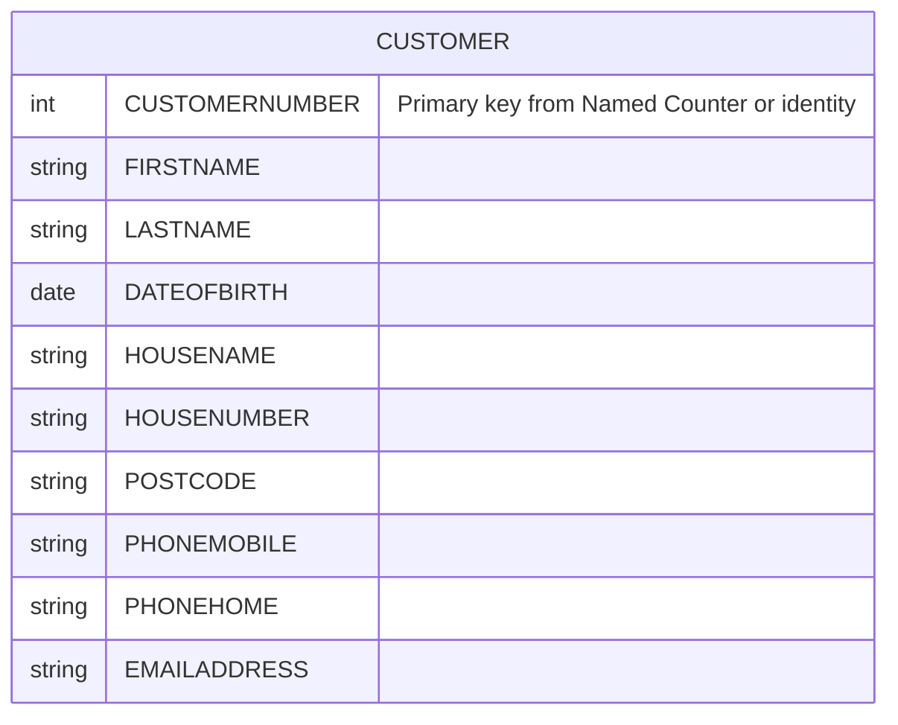

## Table of Contents

- [1. Purpose](#1-purpose)
- [2. Inputs](#2-inputs)
- [3. Outputs](#3-outputs)
- [4. Processing Logic](#4-processing-logic)
  - [4.1 Mermaid Flow Diagram](#41-mermaid-flow-diagram)
  - [4.2 Processing Logic Description](#42-processing-logic-description)
  - [4.3 Database Tables](#43-database-tables)
- [5. Paragraphs](#5-paragraphs)
- [6. Dependencies](#6-dependencies)
  - [6.1 CICS Programs Linked (External Programs / Subroutines)](#61-cics-programs-linked-external-programs--subroutines)
  - [6.2 DB2 Database](#62-db2-database)
  - [6.3 CICS Services](#63-cics-services)
  - [6.4 Copybooks / Include Members](#64-copybooks--include-members)
  - [6.5 Input Data / Communication Area (DFHCOMMAREA)](#65-input-data--communication-area-dfhcommarea)
  - [6.6 Configuration / Hardcoded Values](#66-configuration--hardcoded-values)
- [7. Constraints](#7-constraints)
- [8. Error Handling](#8-error-handling)
  - [8.1 Input Validation and Commarea Checks](#81-input-validation-and-commarea-checks)
  - [8.2 Service Availability and Fallback Logic](#82-service-availability-and-fallback-logic)
  - [8.3 Database Error Handling](#83-database-error-handling)
  - [8.4 Logging and Diagnostic Mechanisms](#84-logging-and-diagnostic-mechanisms)
- [9. Examples](#9-examples)
  - [9.1 Example 1 — Successful Customer Addition (Named Counter Service Available)](#91-example-1--successful-customer-addition-named-counter-service-available)
  - [9.2 Example 2 — Named Counter Service Unavailable (DB2 IDENTITY Path)](#92-example-2--named-counter-service-unavailable-db2-identity-path)
  - [9.3 Example 3 — Communication Area Too Short (Validation Failure)](#93-example-3--communication-area-too-short-validation-failure)
  - [9.4 Example 4 — DB2 INSERT Failure](#94-example-4--db2-insert-failure)

## 1. Purpose

LGACDB01 is a CICS-hosted COBOL program responsible for adding a new customer record to the GenApp DB2 customer database. It receives customer details — including name, address, and date of birth — via the CICS communication area (DFHCOMMAREA), validates that the communication area is sufficiently sized, and then inserts a new row into the DB2 `CUSTOMER` table. A unique customer number is obtained preferentially from the CICS Named Counter Service (GENACUSTNUM); if that service is unavailable, DB2's own `IDENTITY_VAL_LOCAL()` identity assignment is used instead. After the insert, the program links to LGACVS01 to propagate the new customer data to VSAM, and then to LGACDB02 to create a corresponding customer security record in DB2. Any DB2 errors encountered during the insert trigger a diagnostic message — containing the SQLCODE, a timestamp, and a snapshot of the communication area — to be written to a transient data queue via the utility program LGSTSQ before the program returns control to its caller.

## 2. Inputs

- CICS System Fields (EIB - Execute Interface Block)
  - `EIBCALEN`: Holds the length of the incoming communication area passed by the caller. Used to validate that data was received (`EIBCALEN > 0`) and that the commarea meets the minimum required length (`WS-REQUIRED-CA-LEN`).
  - `EIBTRNID`: Contains the CICS transaction identifier for the current task. Captured for runtime and debug tracking.
  - `EIBTRMID`: Contains the terminal identifier associated with the current task. Captured for runtime and debug tracking.
  - `EIBTASKN`: Contains the CICS task number assigned to the current execution. Captured for runtime and debug tracking.

- Inbound Communication Area (`DFHCOMMAREA` / `LGCMAREA`)
  - `CA-FIRST-NAME`: Customer first name provided by the calling program. Used as input for the `CUSTOMER` table insert.
  - `CA-LAST-NAME`: Customer last name provided by the calling program. Used as input for the `CUSTOMER` table insert.
  - `CA-DOB`: Customer date of birth provided by the calling program. Used as input for the `CUSTOMER` table insert.
  - `CA-HOUSE-NAME`: House name of the customer provided by the calling program. Used as input for the `CUSTOMER` table insert.
  - `CA-HOUSE-NUM`: House number of the customer provided by the calling program. Used as input for the `CUSTOMER` table insert.
  - `CA-POSTCODE`: Postcode of the customer address provided by the calling program. Used as input for the `CUSTOMER` table insert.
  - `CA-PHONE-MOBILE`: Mobile phone number provided by the calling program. Used as input for the `CUSTOMER` table insert.
  - `CA-PHONE-HOME`: Home phone number provided by the calling program. Used as input for the `CUSTOMER` table insert.
  - `CA-EMAIL-ADDRESS`: Email address provided by the calling program. Used as input for the `CUSTOMER` table insert.

- External System & Services Data
  - CICS Named Counter Server (`GENACUSTNUM` in pool `GENA`): Provides the next sequential customer identifier via `EXEC CICS GET COUNTER` when the counter server is active.
  - Db2 Identity Function (`IDENTITY_VAL_LOCAL()`): Returns the generated identity value for the customer number column when inserting with Db2 auto-generated defaults (fallback when the named counter is unavailable).
  - Db2 Execution Return Code (`SQLCODE` via `SQLCA`): Provides status and error codes resulting from Db2 `INSERT` operations, determining transaction flow and error logging.
  - CICS Time Services (`ASKTIME` / `FORMATTIME`): Supplies the current system timestamp used for error formatting during error log processing.

## 3. Outputs

- **Return data to the caller (DFHCOMMAREA)**
  - `CA-RETURN-CODE`
    - Set to '00' when processing starts.
    - Set to '98' if the commarea is shorter than the required length (`WS-CA-HEADER-LEN` + `WS-CUSTOMER-LEN`). The program then returns immediately.
    - Set to '90' if either customer INSERT fails (SQLCODE not 0). The program then logs the error and returns.
  - `CA-CUSTOMER-NUM`
    - Holds the newly assigned customer number, copied from `DB2-CUSTOMERNUM-INT`. The caller receives it in the commarea.
    - The number comes from the Named Counter (`LastCustNum`) when `LGAC-NCS` is 'ON'. Otherwise it comes from `IDENTITY_VAL_LOCAL()` after the INSERT.
  - Customer detail fields (name, DOB, address, phone, email) are not modified. They are passed on in the commarea to the linked program LGACVS01.

- **Database output (DB2 CUSTOMER table)**
  - The program inserts one new row per request into `CUSTOMER`. The columns are `CUSTOMERNUMBER`, `FIRSTNAME`, `LASTNAME`, `DATEOFBIRTH`, `HOUSENAME`, `HOUSENUMBER`, `POSTCODE`, `PHONEMOBILE`, `PHONEHOME` and `EMAILADDRESS`.
  - The values come from the commarea fields `CA-FIRST-NAME`, `CA-LAST-NAME`, `CA-DOB`, `CA-HOUSE-NAME`, `CA-HOUSE-NUM`, `CA-POSTCODE`, `CA-PHONE-MOBILE`, `CA-PHONE-HOME` and `CA-EMAIL-ADDRESS`.
  - `LGAC-NCS` controls how `CUSTOMERNUMBER` is set:
    - When 'ON', the explicit value `DB2-CUSTOMERNUM-INT` is inserted.
    - Otherwise `DEFAULT` is used, so DB2 generates the number. The program then reads it back into `DB2-CUSTOMERNUM-INT` with `IDENTITY_VAL_LOCAL()`.

- **Counter service side effect**
  - The `EXEC CICS GET COUNTER` call on `GENACUSTNUM` in pool `GENA` increments the named counter on each request. This is a CICS Named Counter Service side effect.
  - `WS-RESP` holds the result of this call. If it is not NORMAL, `LGAC-NCS` is set to 'NO' and the program uses the DB2 identity path instead.

- **Downstream program calls (CICS LINK)**
  - `LGACVS01`
    - Called with `DFHCOMMAREA` (length 225), which carries the customer details and the new customer number.
  - `LGACDB02`
    - Called with the `CDB2AREA` structure (length 32500), which creates the customer security record.
    - `D2-REQUEST-ID` is set to '02ACUS'.
    - `D2-CUSTOMER-NUM` is the new customer number.
    - `D2-CUSTSECR-PASS` is a fixed 32-character hash value.
    - `D2-CUSTSECR-COUNT` is '0000'.
    - `D2-CUSTSECR-STATE` is 'N'.

- **Error logging output (via LGSTSQ to a transient data queue)**
  - This is written by `WRITE-ERROR-MESSAGE`, which runs on a missing commarea or a failed INSERT.
  - `ERROR-MSG` is the first message. It contains:
    - `EM-DATE` and `EM-TIME`, formatted from `WS-ABSTIME` through `WS-DATE` and `WS-TIME`.
    - The program name 'LGACDB01'.
    - `EM-CUSNUM`.
    - `EM-SQLREQ`, set to ' INSERT CUSTOMER'.
    - `EM-SQLRC`, which holds the SQLCODE.
    - When there is no commarea, `EM-VARIABLE` is overwritten with ' NO COMMAREA RECEIVED'.
  - `CA-ERROR-MSG` is a second message, written only when `EIBCALEN` is greater than 0. It contains 'COMMAREA=' followed by `CA-DATA`, which holds up to the first 90 bytes of the commarea. This gives diagnostic context for the failure.

- **Control flow outcomes**
  - If no commarea is received (`EIBCALEN` = 0), the program writes the error message and abends the task with code 'LGCA' (`NODUMP`).
  - The program ends with `EXEC CICS RETURN` in three cases:
    - Normal completion.
    - The length check fails (return code '98').
    - An INSERT fails (return code '90').

## 4. Processing Logic

### 4.1 Mermaid Flow Diagram

---

### 4.2 Processing Logic Description

**High-level Summary**

LGACDB01 is a CICS COBOL program that adds a new customer. It receives the customer's name, address, date of birth and contact details in the DFHCOMMAREA. It assigns a new customer number and inserts a row into the DB2 `CUSTOMER` table. It then calls LGACVS01 and LGACDB02. LGACDB02 creates the customer's security record. The program reports the outcome to the caller through `CA-RETURN-CODE`.

**Execution Flow**

1. **Initialization.** The program clears `WS-HEADER` and copies the transaction ID, terminal ID and task number from the EIB (`EIBTRNID`, `EIBTRMID`, `EIBTASKN`). These fields are used for diagnostics. It also clears the DB2 host variable `DB2-CUSTOMERNUM-INT`.
2. **Commarea presence check.**
   - If `EIBCALEN` is zero, no commarea was passed.
   - The program puts the text ' NO COMMAREA RECEIVED' into `EM-VARIABLE` and runs `WRITE-ERROR-MESSAGE`.
   - It then abends with code `LGCA` and no dump.
3. **Return code and address setup.**
   - `CA-RETURN-CODE` is set to '00'.
   - `EIBCALEN` is saved in `WS-CALEN`.
   - The commarea address is saved in `WS-ADDR-DFHCOMMAREA`.
4. **Commarea length validation.**
   - The required length is `WS-CA-HEADER-LEN` (18) plus `WS-CUSTOMER-LEN` (from copybook LGPOLICY), accumulated in `WS-REQUIRED-CA-LEN`.
   - If `EIBCALEN` is smaller than this, the program sets return code '98' and returns to the caller with `EXEC CICS RETURN`. It does no further processing.
5. **Obtain customer number (`Obtain-CUSTOMER-Number`).**
   - The program issues `EXEC CICS GET COUNTER(GENACUSTNUM) POOL(GENA) VALUE(LastCustNum)` with `RESP(WS-RESP)`.
   - If the response is not NORMAL, the Named Counter Service is treated as unavailable. `LGAC-NCS` is set to 'NO' and `DB2-CUSTOMERNUM-INT` is cleared.
   - If the response is NORMAL, `LastCustNum` is moved into `DB2-CUSTOMERNUM-INT`.
6. **Insert customer (`INSERT-CUSTOMER`).** `EM-SQLREQ` is set to ' INSERT CUSTOMER'.
   - **Counter available (`LGAC-NCS` = 'ON').** The program inserts the row into `CUSTOMER` with the explicit `DB2-CUSTOMERNUM-INT` as `CUSTOMERNUMBER`. The other columns come from the commarea: first name, last name, date of birth, house name, house number, postcode, mobile phone, home phone and email.
   - **Counter unavailable.** The program inserts the row with `CUSTOMERNUMBER` set to DEFAULT, so DB2 generates the identity value. It then runs `SET :DB2-CUSTOMERNUM-INT = IDENTITY_VAL_LOCAL()` to retrieve the generated number.
   - **Insert failure.** If `SQLCODE` is not zero on either path, the program sets `CA-RETURN-CODE` to '90', runs `WRITE-ERROR-MESSAGE` and returns to the caller immediately.
   - **Insert success.** The customer number is moved to `CA-CUSTOMER-NUM`, so the caller receives it.
7. **Link to LGACVS01.** The program links to LGACVS01, passing the commarea with a length of 225. This is a customer-related follow-on step. In the supplied context it is described as a downstream program that receives the commarea contents.
8. **Prepare and link to LGACDB02.**
   - `CDB2AREA` is populated:
     - `D2-CUSTOMER-NUM` is the new customer number.
     - `D2-REQUEST-ID` is '02ACUS' (add customer security).
     - `D2-CUSTSECR-PASS` is a fixed 32-character hash value.
     - `D2-CUSTSECR-COUNT` is '0000'.
     - `D2-CUSTSECR-STATE` is 'N'.
   - The program links to LGACDB02 with length 32500. LGACDB02 creates the security record.
   - The program does not check the return codes from either link.
9. **Return.** The program issues `EXEC CICS RETURN`.

**Error handling (`WRITE-ERROR-MESSAGE`)**

- `SQLCODE` is moved to `EM-SQLRC`.
- `ASKTIME` and `FORMATTIME` produce the date (MMDDYYYY) and time. These go into `EM-DATE` and `EM-TIME`.
- The program links to `LGSTSQ` with `ERROR-MSG` so that the message is written to the queue.
- If the commarea length is above zero, the program also sends the commarea contents to `LGSTSQ` through `CA-ERROR-MSG`. It sends the whole commarea if it is shorter than 91 bytes and the first 90 bytes otherwise.

**Business rules**

- Return code '00' means success, '98' means the commarea is too short, and '90' means the DB2 insert failed.
- The Named Counter Service is preferred for customer numbers. DB2 identity generation is the fallback.
- Every new customer gets the same fixed initial password hash, a security count of 0000 and a state of 'N'.

**External Interactions**

- **DB2.** The program inserts into the `CUSTOMER` table. It also calls `IDENTITY_VAL_LOCAL()` on the fallback path.
- **CICS Named Counter Server.** `GET COUNTER GENACUSTNUM` in pool `GENA` supplies sequential customer numbers.
- **CICS LINK to LGACVS01.** Follow-on customer processing with the commarea.
- **CICS LINK to LGACDB02.** Creates the customer security record through `CDB2AREA`.
- **CICS LINK to LGSTSQ.** Writes error and commarea diagnostic messages to the queue.
- **CICS ASKTIME and FORMATTIME.** Provide timestamps for error messages.
- **CICS ABEND.** Terminates the task with code `LGCA` when there is no commarea.
- **No IBM MQ operations** appear in this program.

**Plain Language Summary**

This program registers a new customer. It first checks that it was given enough information. If not, it stops and reports a problem. It then gets the next customer number from a numbering service, or lets the database choose one if that service is unavailable. It saves the customer's details in the customer table. If the save fails, it logs the error with the time and date and tells the caller that it failed. If the save works, it passes the new customer number to two other programs. One handles related customer processing. The other sets up the customer's initial login password record. Finally, it hands control back to the caller with the new customer number filled in.

---

### 4.3 Database Tables

## 5. Paragraphs

- **MAINLINE SECTION** — The top-level control paragraph that governs the entire add-customer workflow from entry to return.
  - Initialises `WS-HEADER` and captures the current CICS transaction ID (`EIBTRNID`), terminal ID (`EIBTRMID`), and task number (`EIBTASKN`) into working-storage diagnostics fields.
  - Initialises the DB2 host-variable group `DB2-OUT-INTEGERS`.
  - Validates that a communication area was passed: if `EIBCALEN` is zero, populates `EM-VARIABLE` with a 'NO COMMAREA RECEIVED' message, performs `WRITE-ERROR-MESSAGE`, and issues a CICS ABEND with code `LGCA`.
  - Sets the return code in `CA-RETURN-CODE` to `'00'`, saves `EIBCALEN` into `WS-CALEN`, and anchors `WS-ADDR-DFHCOMMAREA` to the address of `DFHCOMMAREA`.
  - Computes the minimum required commarea length by adding `WS-CA-HEADER-LEN` (18 bytes) and `WS-CUSTOMER-LEN` into `WS-REQUIRED-CA-LEN`; if `EIBCALEN` is less than this threshold, sets return code `'98'` and returns to the caller immediately.
  - If validation passes, performs `Obtain-CUSTOMER-Number` followed by `INSERT-CUSTOMER` to create the DB2 customer record.
  - Issues a CICS LINK to `LGACVS01` passing `DFHCOMMAREA` (225 bytes) to write the customer to the VSAM store.
  - Populates `CDB2AREA` with the newly assigned customer number, request ID `'02ACUS'`, a fixed security password hash, a zero count, and state `'N'`, then issues a CICS LINK to `LGACDB02` (32500 bytes) to create the corresponding customer security record.
  - Concludes with `EXEC CICS RETURN` to hand control back to the caller.

- **MAINLINE-EXIT** — A formal exit point for the `MAINLINE SECTION`; contains only an `EXIT` statement and is never directly PERFORMed.

- **Obtain-CUSTOMER-Number** — Retrieves the next sequential customer number from the CICS Named Counter Service (NCS).
  - Issues `EXEC CICS Get Counter` against the counter named `GENACUSTNUM` in pool `GENA`, storing the result in `LastCustNum` and the CICS response in `WS-RESP`.
  - Conditionally branches: if the response is not `DFHRESP(NORMAL)` (counter service unavailable or failed), sets `LGAC-NCS` to `'NO'` and initialises `DB2-CUSTOMERNUM-INT` to zero, signalling that the DB2 `DEFAULT` identity path should be used in the subsequent INSERT; otherwise moves `LastCustNum` into `DB2-CUSTOMERNUM-INT` to use as the explicit customer number.

- **INSERT-CUSTOMER** — Inserts a new row into the DB2 `CUSTOMER` table using communication area fields as host variables.
  - Sets `EM-SQLREQ` to `' INSERT CUSTOMER'` for error-logging context before any SQL is executed.
  - Branches on the `LGAC-NCS` flag:
    - **NCS ON path**: executes an INSERT supplying `DB2-CUSTOMERNUM-INT` explicitly for `CUSTOMERNUMBER` alongside `CA-FIRST-NAME`, `CA-LAST-NAME`, `CA-DOB`, `CA-HOUSE-NAME`, `CA-HOUSE-NUM`, `CA-POSTCODE`, `CA-PHONE-MOBILE`, `CA-PHONE-HOME`, and `CA-EMAIL-ADDRESS` from the commarea. If `SQLCODE` is non-zero, sets return code `'90'`, performs `WRITE-ERROR-MESSAGE`, and returns to the caller.
    - **NCS OFF path**: executes the same INSERT but supplies `DEFAULT` for `CUSTOMERNUMBER`, allowing DB2's identity column to assign the value automatically. On SQL failure the same `'90'` error path is taken. On success, a second SQL statement `SET :DB2-CUSTOMERNUM-INT = IDENTITY_VAL_LOCAL()` retrieves the DB2-generated customer number back into the host variable.
  - After either branch, moves `DB2-CUSTOMERNUM-INT` into `CA-CUSTOMER-NUM` in the commarea so the assigned customer number is returned to the caller.

- **WRITE-ERROR-MESSAGE** — A reusable error-reporting paragraph that formats and dispatches diagnostic messages to the transient data queue via `LGSTSQ`.
  - Moves the current `SQLCODE` into `EM-SQLRC` within the `ERROR-MSG` structure.
  - Obtains the current absolute time via `EXEC CICS ASKTIME` into `WS-ABSTIME`, then formats it into `WS-DATE` (MM/DD/YYYY) and `WS-TIME` via `EXEC CICS FORMATTIME`; these are copied into `EM-DATE` and `EM-TIME`.
  - Issues a CICS LINK to `LGSTSQ` passing the full `ERROR-MSG` structure.
  - Conditionally captures a snapshot of the commarea into `CA-DATA` for a second `LGSTSQ` LINK: if `EIBCALEN` is between 1 and 90, copies the exact commarea contents; if greater than 90, copies only the first 90 bytes — guarding against overwriting the fixed 90-byte `CA-DATA` field. If `EIBCALEN` is zero, the commarea snapshot step is skipped entirely.

## 6. Dependencies

### 6.1 CICS Programs Linked (External Programs / Subroutines)

- **LGACVS01** — invoked via `EXEC CICS LINK` with `DFHCOMMAREA` (length 225); responsible for persisting customer data to VSAM after the DB2 INSERT completes
- **LGACDB02** — invoked via `EXEC CICS LINK` with `CDB2AREA` (length 32500); creates the customer security record in DB2 for the newly inserted customer; receives the request ID `'02ACUS'`, the assigned customer number, a hashed password, a count, and a state flag
- **LGSTSQ** — invoked via `EXEC CICS LINK` (called up to twice) within `WRITE-ERROR-MESSAGE`; writes diagnostic error messages and a COMMAREA snapshot to the transient data queue for problem determination

---

### 6.2 DB2 Database

- **CUSTOMER table** — the primary DB2 table written by this program; an `INSERT` statement populates the columns `CUSTOMERNUMBER`, `FIRSTNAME`, `LASTNAME`, `DATEOFBIRTH`, `HOUSENAME`, `HOUSENUMBER`, `POSTCODE`, `PHONEMOBILE`, `PHONEHOME`, and `EMAILADDRESS`
  - When the CICS Named Counter Service is available (`LGAC-NCS = 'ON'`), `CUSTOMERNUMBER` is supplied explicitly from the counter value
  - When the Named Counter Service is unavailable, `DEFAULT` identity assignment is used and the generated value is retrieved via `IDENTITY_VAL_LOCAL()`
- **SQLCA (SQL Communications Area)** — included via `EXEC SQL INCLUDE SQLCA`; provides `SQLCODE` which is tested after every SQL statement to detect failures and drive error handling
- **`IDENTITY_VAL_LOCAL()`** — DB2 scalar function called via `EXEC SQL SET :DB2-CUSTOMERNUM-INT = IDENTITY_VAL_LOCAL()` to retrieve the system-generated customer number when the Named Counter Service path is not taken

---

### 6.3 CICS Services

- **CICS Named Counter Service** — counter name `GENACUSTNUM` in pool `GENA`; used via `EXEC CICS GET COUNTER` to obtain a sequentially generated customer number; if the call does not return `DFHRESP(NORMAL)` the program falls back to DB2 identity assignment
- **`EIBCALEN`** (CICS EIB field) — length of the inbound COMMAREA; validated against the computed minimum required length; a zero value causes an immediate ABEND (`LGCA`), and a length shorter than required causes return code `'98'` and an early return
- **`EIBTRNID` / `EIBTRMID` / `EIBTASKN`** (CICS EIB fields) — transaction ID, terminal ID, and task number captured into `WS-HEADER` for diagnostic purposes
- **`EXEC CICS ASKTIME` / `EXEC CICS FORMATTIME`** — used in `WRITE-ERROR-MESSAGE` to obtain and format the current timestamp for inclusion in error log entries
- **`EXEC CICS ABEND ABCODE('LGCA')`** — issued when no COMMAREA is received; terminates the task abnormally with a named abend code
- **`EXEC CICS RETURN`** — used both for normal program termination and for early-exit error paths

---

### 6.4 Copybooks / Include Members

- **`LGPOLICY`** — copied into Working-Storage via `COPY LGPOLICY`; provides `WS-CUSTOMER-LEN` (the customer data length constant) and related policy/customer data layout fields used in COMMAREA length validation
- **`LGCMAREA`** — included via `EXEC SQL INCLUDE LGCMAREA` inside the `LINKAGE SECTION` definition of `DFHCOMMAREA`; defines the full layout of the CICS COMMAREA including `CA-RETURN-CODE`, `CA-CUSTOMER-NUM`, `CA-FIRST-NAME`, `CA-LAST-NAME`, `CA-DOB`, `CA-HOUSE-NAME`, `CA-HOUSE-NUM`, `CA-POSTCODE`, `CA-PHONE-MOBILE`, `CA-PHONE-HOME`, and `CA-EMAIL-ADDRESS`
- **`SQLCA`** — included via `EXEC SQL INCLUDE SQLCA`; the standard DB2 SQL Communications Area providing `SQLCODE` and related fields

---

### 6.5 Input Data / Communication Area (DFHCOMMAREA)

- **`CA-RETURN-CODE`** — output field set to `'00'` on entry, `'90'` on SQL failure, or `'98'` on COMMAREA length mismatch; returned to the caller
- **`CA-CUSTOMER-NUM`** — output field populated with the newly assigned customer number after the INSERT
- **`CA-FIRST-NAME`, `CA-LAST-NAME`, `CA-DOB`** — customer personal data fields sourced from the inbound COMMAREA and used directly as DB2 host variables in the INSERT
- **`CA-HOUSE-NAME`, `CA-HOUSE-NUM`, `CA-POSTCODE`** — customer address fields sourced from the inbound COMMAREA and used as DB2 host variables
- **`CA-PHONE-MOBILE`, `CA-PHONE-HOME`, `CA-EMAIL-ADDRESS`** — customer contact fields sourced from the inbound COMMAREA and used as DB2 host variables

---

### 6.6 Configuration / Hardcoded Values

- **`GENACUSTNUM`** (counter name) and **`GENA`** (pool name) — hardcoded Working-Storage literals identifying the CICS Named Counter Service resource used for customer number generation
- **`'5732fec825535eeafb8fac50fee3a8aa'`** — hardcoded initial customer security password hash moved into `D2-CUSTSECR-PASS` before linking to `LGACDB02`
- **`WS-CA-HEADER-LEN = +18`** — hardcoded constant defining the fixed COMMAREA header size used in minimum-length validation
- **`LGCA`** — hardcoded ABEND code issued when no COMMAREA is present

## 7. Constraints

-  Commarea presence and size
  -  A commarea must be passed.
    -  If `EIBCALEN` is zero, the program writes " NO COMMAREA RECEIVED" to the error message through `WRITE-ERROR-MESSAGE`.
    -  It then abends with `ABCODE('LGCA') NODUMP`, so no dump is taken.
  -  The commarea must be at least as long as the header plus the customer data.
    -  `WS-REQUIRED-CA-LEN` is built by adding `WS-CA-HEADER-LEN` (18) and `WS-CUSTOMER-LEN` (72, from the `LGPOLICY` copybook).
    -  The required minimum is therefore 90 bytes.
    -  If `EIBCALEN` is less than that, `CA-RETURN-CODE` is set to '98' and the program issues `EXEC CICS RETURN`. No database work is done.
  -  `CA-RETURN-CODE` is set to '00' before the length check, so success is the default until an error is found.
  -  The `LGCMAREA` layout fixes the field sizes the caller must respect.
    -  The customer request fields are `CA-FIRST-NAME` X(10), `CA-LAST-NAME` X(20), `CA-DOB` X(10), `CA-HOUSE-NAME` X(20), `CA-HOUSE-NUM` X(4), `CA-POSTCODE` X(8), `CA-PHONE-MOBILE` X(20), `CA-PHONE-HOME` X(20) and `CA-EMAIL-ADDRESS` X(100).
    -  `CA-CUSTOMER-NUM` is PIC 9(10) and `CA-RETURN-CODE` is PIC 9(2).
  -  The program does not check the content of these fields. There is no check for required fields, date format, numeric format or email format. Only DB2 column definitions and constraints can reject bad content.

-  Customer number assignment
  -  A customer number is requested from the CICS Named Counter Service before the insert.
    -  The counter is `GENACUSTNUM` in pool `GENA`.
    -  The command is `EXEC CICS GET COUNTER ... VALUE(LastCustNum) RESP(WS-RESP)`.
  -  The result of the counter request decides how the number is assigned.
    -  If `WS-RESP` is `DFHRESP(NORMAL)`, the counter value is moved to `DB2-CUSTOMERNUM-INT`. `LGAC-NCS` stays 'ON'.
    -  If `WS-RESP` is anything else, `LGAC-NCS` is set to 'NO' and `DB2-CUSTOMERNUM-INT` is initialised. The program then relies on DB2 to generate the number.
    -  A counter failure is not treated as an error. The program falls back silently and returns no error code.
  -  The assigned customer number is held in a 9-digit binary field (`PIC S9(9) COMP`).
    -  It is moved to `CA-CUSTOMER-NUM` (9(10)) and `D2-CUSTOMER-NUM` (9(10)).
    -  The counter value in `LastCustNum` is `PIC S9(8) COMP`, so it is limited to 8 digits.

-  Insert path
  -  The path is chosen by the `LGAC-NCS` flag.
    -  If `LGAC-NCS` = 'ON', the insert supplies `:DB2-CUSTOMERNUM-INT` explicitly as `CUSTOMERNUMBER`.
    -  Otherwise the insert uses `DEFAULT` for `CUSTOMERNUMBER`. The generated value is then read back with `SET :DB2-CUSTOMERNUM-INT = IDENTITY_VAL_LOCAL()`.
    -  In the fallback path the `CUSTOMERNUMBER` column must be a DB2 identity or default-generated column.
  -  `IDENTITY_VAL_LOCAL()` is only valid after the insert has succeeded, in the same unit of work.
    -  The call comes after the SQLCODE check and the early return on failure.
    -  Its own SQLCODE is not checked.
  -  Both paths insert the same ten columns: `CUSTOMERNUMBER`, `FIRSTNAME`, `LASTNAME`, `DATEOFBIRTH`, `HOUSENAME`, `HOUSENUMBER`, `POSTCODE`, `PHONEMOBILE`, `PHONEHOME` and `EMAILADDRESS`.
    -  `CA-NUM-POLICIES` is not stored.
  -  The insert must succeed, meaning `SQLCODE` must be 0.
    -  On any non-zero SQLCODE, `CA-RETURN-CODE` is set to '90' and the error is logged. The program then returns immediately.
    -  Duplicate keys, constraint violations and similar failures all follow this path.
    -  Because the program returns immediately, the later security and VSAM steps are skipped on failure.

-  Sequencing
  -  Steps must run in this order.
    -  Receive the commarea.
    -  Check that the commarea exists.
    -  Initialise the return code.
    -  Check the commarea length.
    -  Obtain the customer number.
    -  Insert the customer row.
    -  Link to `LGACVS01`.
    -  Set up `CDB2AREA` and link to `LGACDB02`.
    -  Return.
  -  The customer number must be known before the security record is created.
    -  `D2-CUSTOMER-NUM` is populated from `DB2-CUSTOMERNUM-INT` only after the insert has completed.
  -  The VSAM link to `LGACVS01` passes the full `DFHCOMMAREA` with a fixed `LENGTH(225)`.
    -  That is after the customer number is placed in `CA-CUSTOMER-NUM`.
    -  It assumes the caller's commarea holds at least 225 bytes. The program only checks for 90 bytes.
    -  The length is hard-coded, not derived from `EIBCALEN`.
  -  The security link to `LGACDB02` uses `CDB2AREA` with a fixed `LENGTH(32500)`, which matches the 32,500-byte structure (6+2+10+32+4+1+32445).

-  Security record defaults
  -  The initial security data passed to `LGACDB02` is fixed.
    -  `D2-REQUEST-ID` = '02ACUS', which selects the add-customer-security operation.
    -  `D2-CUSTSECR-PASS` = a fixed 32-character hash literal.
    -  `D2-CUSTSECR-COUNT` = '0000'.
    -  `D2-CUSTSECR-STATE` = 'N'.
  -  Every new customer therefore gets the same initial password hash, and the caller cannot override it.
  -  The unused working-storage fields `WS-CS-PASSWORD`, `WS-CS-STATE` and `WS-CA-COUNT` do not affect the security data.
  -  The return codes from the `LGACVS01` and `LGACDB02` links are not checked, and no `RESP` is requested.
    -  Failures in those programs surface only as CICS abends.
    -  The program does not set its own return code for them.

-  Error handling and logging
  -  Error records are written by `WRITE-ERROR-MESSAGE`.
    -  The program queries `SQLCODE`, moves it to `EM-SQLRC` (signed display), and records date (MMDDYYYY) and time from `ASKTIME` and `FORMATTIME`.
    -  The record is passed through `EXEC CICS LINK PROGRAM('LGSTSQ')` using `ERROR-MSG`.
    -  `EM-SQLREQ` holds ' INSERT CUSTOMER' during the insert. It is not set for the missing-commarea error, where `EM-VARIABLE` is overwritten with the message text.
  -  A snapshot of the commarea is logged after the error message, but it is capped at 90 bytes.
    -  If `EIBCALEN` is 1 to 90, only `DFHCOMMAREA(1:EIBCALEN)` is moved to `CA-DATA`.
    -  If `EIBCALEN` is greater than 90, only the first 90 bytes are logged.
    -  If `EIBCALEN` is 0, no snapshot is written.
    -  `CA-DATA` is X(90).
  -  The return codes seen by the caller are:
    -  '00' means success.
    -  '98' means the commarea is too short.
    -  '90' means the DB2 insert failed.
  -  The length-check failure ('98') returns without calling `WRITE-ERROR-MESSAGE`, so nothing is logged for it.
  -  The "no commarea" case abends because there is no commarea to hold a return code.

-  Data type and capacity limits
  -  `WS-REQUIRED-CA-LEN` and `WS-CA-HEADER-LEN` are 4-digit fields, which is ample for the 90-byte requirement.
  -  `WS-CALEN` is `PIC S9(4) COMP`, which holds up to 9,999. A larger commarea would be truncated in that debug field only.
  -  `EM-SQLRC` is `PIC +9(5)`, which holds 5 digits plus a sign. Larger SQLCODE magnitudes would be truncated.
  -  `EM-CUSNUM` (X(10)) is defined but never populated, so the log's customer number stays blank.
  -  `D2-RETURN-CODE` is defined in `CDB2AREA` but not checked.

-  Transaction and unit of work
  -  The program contains no explicit `SYNCPOINT` or `ROLLBACK`.
    -  The customer insert is committed or backed out with the CICS task.
    -  If a later link abends, the insert is backed out, because it is in the same unit of work.
    -  The error-path `EXEC CICS RETURN` after a failed insert leaves any earlier changes to the normal task-end commit logic.
  -  The program is a CICS command-level program using DB2. It needs the CICS-DB2 connection, the `CUSTOMER` table, the Named Counter pool 'GENA' (optional because of the fallback), and the `LGSTSQ`, `LGACVS01` and `LGACDB02` programs to be defined and available.
  -  The program uses no IBM MQ operations.

## 8. Error Handling

### 8.1 Input Validation and Commarea Checks

- Missing Communication Area Detection
  - The program checks the CICS communication area length (`EIBCALEN`) upon entry in the mainline routine.
  - If `EIBCALEN` is equal to zero, indicating that no communication area was passed, an error description message is prepared and logged by invoking the error-logging routine.
  - The program immediately terminates abnormal execution by issuing a `CICS ABEND` command with abend code `LGCA` and no dump requested (`NODUMP`).

- Insufficient Communication Area Length Verification
  - The required communication area size is dynamically calculated by summing the fixed header length (`WS-CA-HEADER-LEN`) and the customer record length (`WS-CUSTOMER-LEN`).
  - If `EIBCALEN` is less than the calculated required length (`WS-REQUIRED-CA-LEN`), the program sets the communication area return code (`CA-RETURN-CODE`) to `'98'` and immediately terminates processing by issuing an `EXEC CICS RETURN` command back to the caller.

### 8.2 Service Availability and Fallback Logic

- CICS Named Counter Service Fallback
  - When attempting to retrieve the next sequential customer number from the CICS Named Counter (`GENACUSTNUM` in pool `GENA`), the program inspects the CICS response code (`WS-RESP`).
  - If `WS-RESP` is not equal to `DFHRESP(NORMAL)`, the Named Counter Service is deemed unavailable or failing.
  - The program handles this condition gracefully by toggling the Named Counter switch (`LGAC-NCS`) from `'ON'` to `'NO'` and initializing the host customer number variable to zeros.
  - During the subsequent customer insert step, detecting `LGAC-NCS = 'NO'` directs execution to an alternate SQL path that relies on Db2 identity column generation (`DEFAULT`) and retrieves the generated identity value via `IDENTITY_VAL_LOCAL()`, thereby providing transparent database-level key generation fallback.

### 8.3 Database Error Handling

- SQL Insert Execution Validation
  - After executing the `INSERT INTO CUSTOMER` statement (under both the Named Counter path and the Db2 identity fallback path), the program evaluates the Db2 return code (`SQLCODE`).
  - If `SQLCODE` is non-zero, indicating a database failure (such as constraint violation, duplicate key, or connection issue), the program sets `CA-RETURN-CODE` to `'90'`.
  - It then executes the error logging paragraph (`WRITE-ERROR-MESSAGE`) to persist error diagnostics and issues an `EXEC CICS RETURN` command to terminate execution and return control to the caller.

### 8.4 Logging and Diagnostic Mechanisms

- Error Message Assembly and Timestamping
  - In the `WRITE-ERROR-MESSAGE` routine, the current Db2 `SQLCODE` is captured and formatted into the structured error record (`ERROR-MSG`).
  - System time is retrieved using `EXEC CICS ASKTIME` and formatted into separate date and time strings via `EXEC CICS FORMATTIME` before being placed into the error record alongside the program identifier (`LGACDB01`) and the operation name (`INSERT CUSTOMER`).

- Centralized Error Logging via Transient Data Queue
  - The formatted error message is logged by calling the shared logging utility program `LGSTSQ` using `EXEC CICS LINK`.
  - In addition to the error text, if `EIBCALEN` is greater than zero, the program extracts a diagnostic snapshot of the incoming communication area data (up to the first 90 bytes) into `CA-ERROR-MSG` and issues a second `EXEC CICS LINK` to `LGSTSQ` to record the input state at the time of failure.

## 9. Examples

### 9.1 Example 1 — Successful Customer Addition (Named Counter Service Available)

**Input (DFHCOMMAREA fields):**

| Field | Value |
|---|---|
| `CA-FIRST-NAME` | `John` |
| `CA-LAST-NAME` | `Smith` |
| `CA-DOB` | `1985-06-15` |
| `CA-HOUSE-NAME` | `Maple House` |
| `CA-HOUSE-NUM` | `12` |
| `CA-POSTCODE` | `SW1A 1AA` |
| `CA-PHONE-MOBILE` | `07700900123` |
| `CA-PHONE-HOME` | `02071234567` |
| `CA-EMAIL-ADDRESS` | `john.smith@example.com` |
| EIBCALEN | ≥ 18 (header) + customer data length |

**Processing:**
1. EIBCALEN is non-zero and meets the minimum length check — processing continues.
2. `Obtain-CUSTOMER-Number` issues a CICS **Get Counter** against pool `GENA`, counter `GENACUSTNUM`. The call succeeds (`WS-RESP = DFHRESP(NORMAL)`), returning, say, `1000042` → stored in `DB2-CUSTOMERNUM-INT`; `LGAC-NCS` remains `'ON'`.
3. `INSERT-CUSTOMER` (NCS path) inserts a row into the `CUSTOMER` table using `1000042` as the explicit `CUSTOMERNUMBER`. SQLCODE = 0.
4. `DB2-CUSTOMERNUM-INT` (1000042) is moved to `CA-CUSTOMER-NUM` in DFHCOMMAREA.
5. CICS LINKs to `LGACVS01` (VSAM record creation) passing the full COMMAREA.
6. CDB2AREA is populated: `D2-REQUEST-ID = '02ACUS'`, `D2-CUSTOMER-NUM = 0000001000042`, password hash set; CICS LINKs to `LGACDB02` to create the customer security record.

**Expected output (DFHCOMMAREA on return):**

| Field | Value |
|---|---|
| `CA-RETURN-CODE` | `00` |
| `CA-CUSTOMER-NUM` | `0000001000042` |

---

### 9.2 Example 2 — Named Counter Service Unavailable (DB2 IDENTITY Path)

**Input (DFHCOMMAREA fields):** Same customer data as Example 1, but the CICS Named Counter Service is down or returns a non-normal response.

**Processing:**
1. Length validation passes as before.
2. `Obtain-CUSTOMER-Number` calls CICS **Get Counter**; the response is not `DFHRESP(NORMAL)`. `LGAC-NCS` is set to `'NO'` and `DB2-CUSTOMERNUM-INT` is initialised to zero.
3. `INSERT-CUSTOMER` (non-NCS path) issues the INSERT with `DEFAULT` for `CUSTOMERNUMBER`, allowing Db2 to assign the next identity value automatically.
4. A second SQL statement `SET :DB2-CUSTOMERNUM-INT = IDENTITY_VAL_LOCAL()` retrieves the Db2-assigned number, e.g. `2000001`.
5. `2000001` is moved to `CA-CUSTOMER-NUM`. The rest of the flow (LGACVS01 and LGACDB02 links) proceeds identically to Example 1.

**Expected output (DFHCOMMAREA on return):**

| Field | Value |
|---|---|
| `CA-RETURN-CODE` | `00` |
| `CA-CUSTOMER-NUM` | `0000002000001` |

---

### 9.3 Example 3 — Communication Area Too Short (Validation Failure)

**Input:** DFHCOMMAREA is passed with EIBCALEN = `10` (below the required minimum of 18-byte header + customer data length).

**Processing:**
1. EIBCALEN is non-zero — the ABEND check passes.
2. `WS-REQUIRED-CA-LEN` is computed as `WS-CA-HEADER-LEN (18) + WS-CUSTOMER-LEN` — the result exceeds `10`.
3. The length guard fires: `CA-RETURN-CODE` is set to `'98'` and `EXEC CICS RETURN` is executed immediately. No DB2 INSERT, no downstream LINKs.

**Expected output (DFHCOMMAREA on return):**

| Field | Value |
|---|---|
| `CA-RETURN-CODE` | `98` |
| `CA-CUSTOMER-NUM` | *(unchanged / unpopulated)* |

---

### 9.4 Example 4 — DB2 INSERT Failure

**Input:** Valid COMMAREA length and a successful NCS counter retrieval, but the DB2 INSERT fails (e.g., duplicate key), returning SQLCODE = `-803`.

**Processing:**
1. Length and NCS steps succeed; `DB2-CUSTOMERNUM-INT` is set to the NCS value.
2. The INSERT executes but SQLCODE ≠ 0.
3. `CA-RETURN-CODE` is set to `'90'`. `WRITE-ERROR-MESSAGE` is called: the current timestamp is obtained via `ASKTIME`/`FORMATTIME`, an error record including the SQLCODE (`-803`) and the operation label `' INSERT CUSTOMER'` is written to the transient data queue via `LGSTSQ`. Up to 90 bytes of the COMMAREA are also logged.
4. `EXEC CICS RETURN` exits without calling LGACVS01 or LGACDB02.

**Expected output (DFHCOMMAREA on return):**

| Field | Value |
|---|---|
| `CA-RETURN-CODE` | `90` |
| `CA-CUSTOMER-NUM` | *(unpopulated)* |

---

Generated by IBM Bob Premium Package for Z
